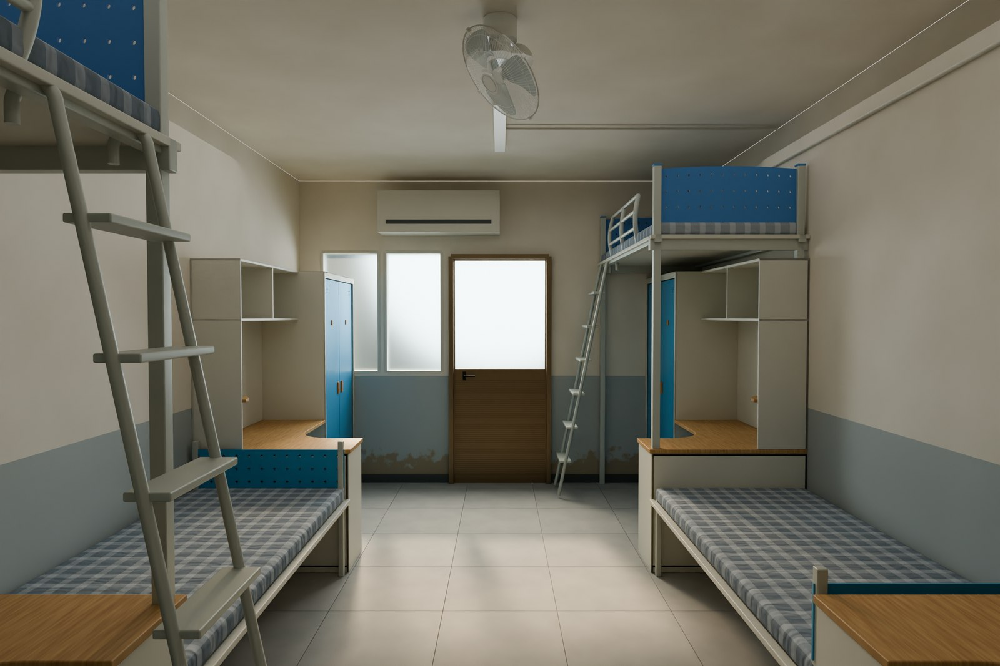
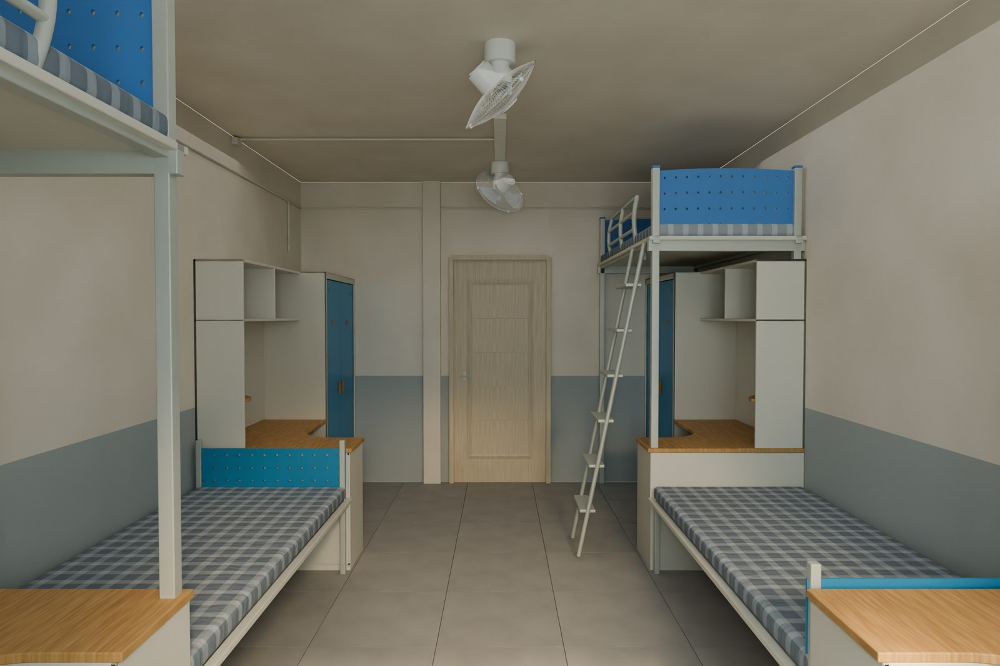
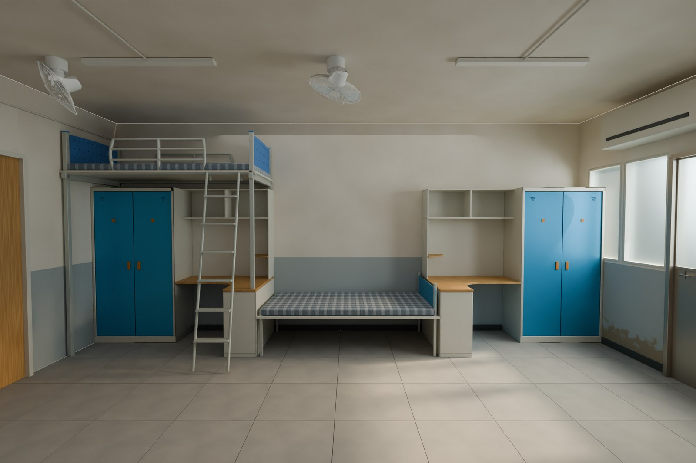
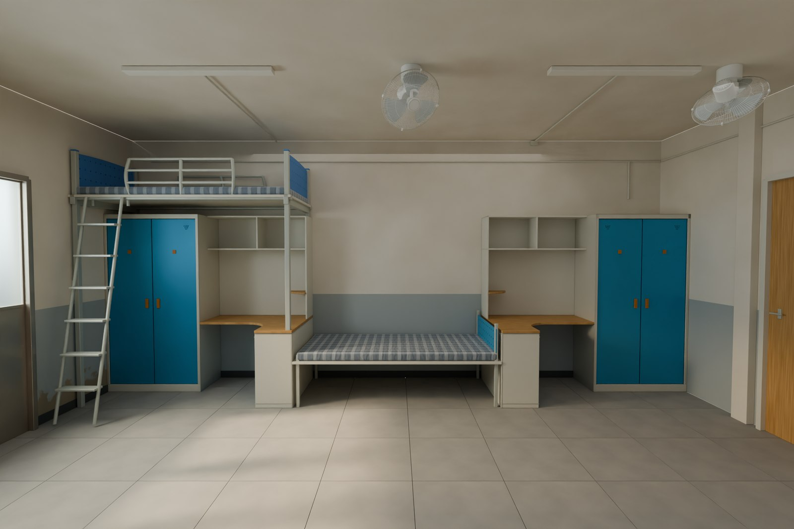
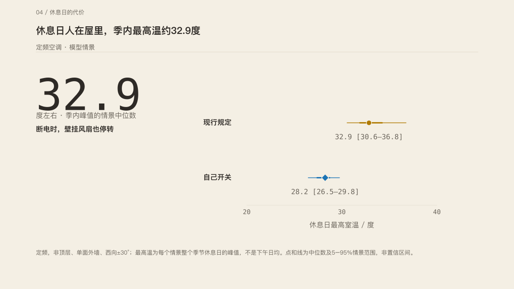
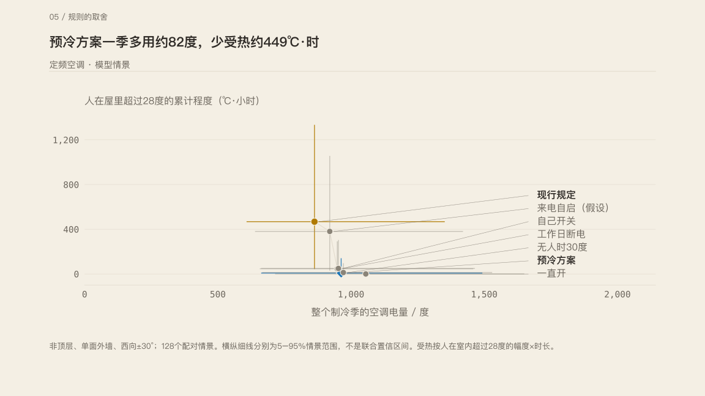
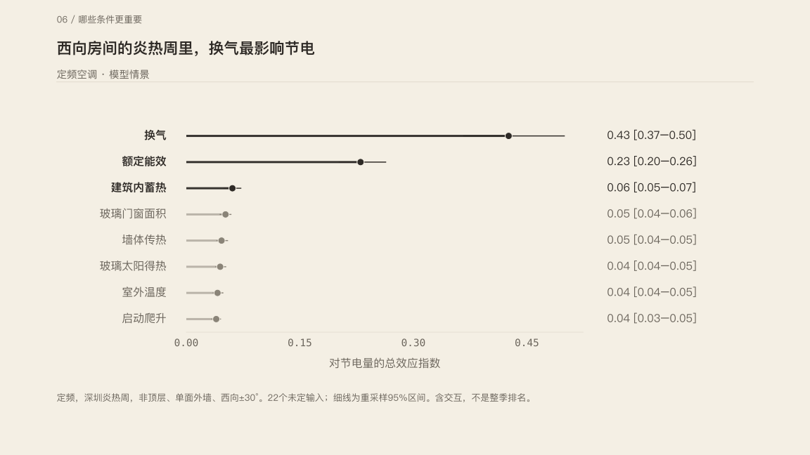

<picture>
  <source media="(prefers-color-scheme: dark)" srcset="readme-assets/cover-en-dark.png">
  
</picture>

<p align="center">
  <a href="模型与来源.md">Model &amp; sources (Chinese)</a> ·
  <a href="results/">Results data</a> ·
  <a href="figures/">All figures</a> ·
  <a href="https://github.com/Ming-Sir-69">Author</a>
</p>

<p align="center">
  <a href="LICENSE"></a>
  
  
  
  
  
</p>

<p align="center">
  <a href="README.md">简体中文</a> · <b>English</b>
</p>

# Dorm air conditioning: self-switching vs. scheduled power cuts, energy use and indoor heat and humidity

This study compares two power rules for a four-person factory dormitory room in southern China: cutting power to the whole room during working hours (rest days included), and supplying power all day while occupants switch the air conditioner themselves. A minute-step model with a three-node thermal network and a humidity node computes air-conditioning energy and indoor temperature and humidity over one cooling season (184 days) for 128 paired parameter scenarios.

## Main results

**The two rules differ mainly on rest days and after work, when occupants are in the room but the power is cut; on workdays their energy use is essentially the same.**

- Workdays: median difference in daily energy, 0.03 kWh.
- Season: with a fixed-speed unit, self-switching uses **72 kWh** more than the scheduled cut (43–123); with an inverter unit, 56 kWh (35–90).
- Rest days: under the scheduled cut, the season peak indoor temperature during occupied hours is **91°F** (32.9°C; 87–98°F).

Basis: median (5–95% scenario range) over 128 paired parameter samples (west-facing ±30°, second floor not top, one exterior wall); three room sizes, two unit types and seven rules share occupancy calendars and weather. Ranges reflect parameter uncertainty, not confidence intervals.

## Study object

Net room size 3.70 × 6.20 × 2.80 m: a 2.10 m desk-and-loft unit at each end and a 2.00 m floor-bed section in the middle. Two loft beds, two floor beds, four L-shaped desks and four double lockers form the thermal mass and occupant heat sources of four people; two frosted windows and the upper half of the balcony door give 1.90 m² of net glazing, and the dark aluminium lower door panel and frames are modelled as a separate opaque heat path.




<details>
<summary><b>Other views: balcony, left wall, right wall</b></summary>







</details>

## Method

- Geometry and components: dimensions, furniture and openings as described above; balcony facing west (270° ±30°).
- Heat and moisture model: three thermal nodes (air; interior walls and furniture; exterior wall and roof) plus air humidity and coil water; one-minute integration driven by hourly weather.
- Power and occupancy: four cuts a day (08:00–10:30, 10:40–12:00, 13:30–15:00, 15:10–17:30); after power returns the unit must be switched on by hand, and the room is unoccupied during the two 10-minute workday windows.
- Units: fixed-speed and inverter, with minimum on/off times, part-load efficiency and dehumidification.
- Parameter values, sources and assumed ranges: [Model &amp; sources](模型与来源.md) (Chinese).

## Figures

Figure text is in Chinese; each title states its finding.

### Indoor temperature and humidity over a day

During the short workday power windows the room is unoccupied and the unit stays off; it is switched on when occupants return at lunch. Curves are 30-minute moving averages.

<picture>
  <source media="(max-width: 600px) and (prefers-color-scheme: dark)" srcset="figures/02_一天室温_暗_窄.svg">
  <source media="(max-width: 600px)" srcset="figures/02_一天室温_亮_窄.svg">
  <source media="(prefers-color-scheme: dark)" srcset="figures/02_一天室温_暗.svg">
  
</picture>

<picture>
  <source media="(max-width: 600px) and (prefers-color-scheme: dark)" srcset="figures/03_一天湿度_暗_窄.svg">
  <source media="(max-width: 600px)" srcset="figures/03_一天湿度_亮_窄.svg">
  <source media="(prefers-color-scheme: dark)" srcset="figures/03_一天湿度_暗.svg">
  
</picture>

### Indoor temperature during occupied rest-day hours

<picture>
  <source media="(max-width: 600px) and (prefers-color-scheme: dark)" srcset="figures/04_休息日_暗_窄.svg">
  <source media="(max-width: 600px)" srcset="figures/04_休息日_亮_窄.svg">
  <source media="(prefers-color-scheme: dark)" srcset="figures/04_休息日_暗.svg">
  
</picture>

### Energy and heat exposure by rule

<picture>
  <source media="(max-width: 600px) and (prefers-color-scheme: dark)" srcset="figures/05_规则取舍_暗_窄.svg">
  <source media="(max-width: 600px)" srcset="figures/05_规则取舍_亮_窄.svg">
  <source media="(prefers-color-scheme: dark)" srcset="figures/05_规则取舍_暗.svg">
  
</picture>

### Sensitivity

<picture>
  <source media="(max-width: 600px) and (prefers-color-scheme: dark)" srcset="figures/06_影响因素_暗_窄.svg">
  <source media="(max-width: 600px)" srcset="figures/06_影响因素_亮_窄.svg">
  <source media="(prefers-color-scheme: dark)" srcset="figures/06_影响因素_暗.svg">
  
</picture>

## Limitations

- The model is not calibrated against on-site energy or temperature/humidity measurements, nor cross-checked against EnergyPlus or similar tools; results hold under the modelled boundary conditions.
- Ventilation rate, floor position (treated as not the top floor) and unit performance curves are assumptions. In the sensitivity analysis, ventilation has the largest effect on savings, followed by rated efficiency.
- Top-floor and corner rooms show markedly larger differences; see the comparison tables in the Chinese README.

## Reproduction

Environment: Python 3.12 and uv. From the repository root:

```sh
uv run --frozen python -m pytest -q
uv run --frozen python run_confirmed.py
uv run --frozen python verify_confirmed.py
uv run --frozen python render_figures.py --report
```

## Detailed data

The full tables (orientation and roof/corner comparisons, energy by rule, recovery in each power window, rest-day exposure, room-size comparison, cycling and sensitivity) are in the [Chinese README](README.md#详细数据), folded under 详细数据. Raw results are in `results/`.

## Repository structure

| Path | Contents |
|---|---|
| `src/` | Heat-and-moisture and AC models |
| `run_confirmed.py`, `verify_confirmed.py` | Runs and checks for the final room |
| `results/` | Summary tables and minute-by-minute traces (`.csv.gz`) |
| `figures/` | All figures, light/dark and wide/narrow |
| `data/` | Original weather files, room evidence and parameters |
| `scene/` | Dorm scene rebuild (Blender), not used in the calculation |
| `模型与来源.md` | Parameters, sources and assumptions (Chinese) |

---

Maintained by **✦ EricMingle69** · [Ming-Sir-69](https://github.com/Ming-Sir-69)  
Code is released under the [MIT License](LICENSE); text and figures under [CC BY 4.0](https://creativecommons.org/licenses/by/4.0/); weather data keep their original licences.
