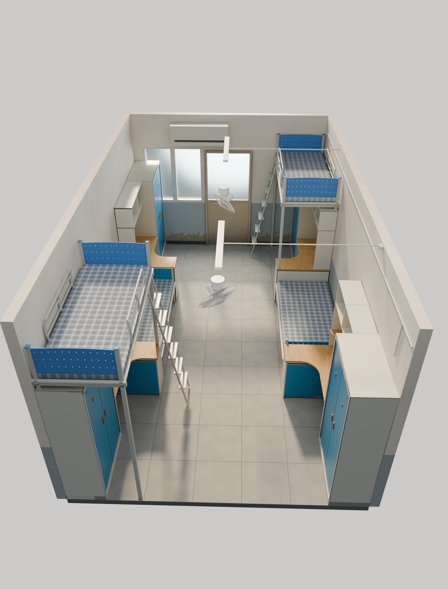

<picture>
  <source media="(prefers-color-scheme: dark)" srcset="readme-assets/cover-en-dark.png">
  
</picture>

<p align="center">
  <a href="模型与来源.md">Model &amp; sources (Chinese)</a> ·
  <a href="results/">Results data</a> ·
  <a href="figures/">All figures</a> ·
  <a href="https://github.com/Ming-Sir-69">Author</a>
</p>

<p align="center">
  <a href="LICENSE"></a>
  
  
  
  
  
</p>

<p align="center">
  <a href="README.md">简体中文</a> · <b>English</b>
</p>

# Dorm air conditioning: pre-cooling and rest-day power vs. scheduled power cuts, energy use and indoor heat and humidity

This project compares two power rules for a four-person factory dormitory room in southern China. The current rule cuts power to the whole room during working hours, applies the same schedule on rest days, and requires occupants to switch the air conditioner back on by hand. The alternative pre-cools the room on workdays by starting the unit ahead of the lunch and evening returns, and keeps power on during rest days. A minute-step model with a three-node thermal network and a humidity node computes air-conditioning energy and indoor temperature and humidity over one cooling season (184 days) for 128 paired parameter scenarios.

## Main results

**The energy difference comes mainly from rest days: about 0.1 kWh per workday and 1.3 kWh per rest day. In return, indoor temperature on arrival and during occupied rest-day hours drops markedly.**

- Season energy: pre-cooling with rest-day power uses **82 kWh** more than the current rule (51–160, fixed-speed); 62 kWh with an inverter unit (37–117).
- Indoor temperature on arrival after work: **85°F → 80°F** (29.4°C → 26.6°C); median time to reach 28°C falls from 29 to 4 minutes.
- Season peak indoor temperature during occupied rest-day hours: **91°F → 83°F** (32.9°C → 28.2°C).
- Occupied heat exposure (degrees above 28°C times hours) falls by 449 °C·h (47–1253).

Basis: median (5–95% scenario range), fixed-speed unit; 128 paired parameter samples (west-facing ±30°, second floor not top, one exterior wall) with shared occupancy calendars and weather. Pre-cooling lead time 30 minutes in the base case, 10–60 minutes across scenarios. Ranges reflect parameter uncertainty, not confidence intervals.

## Study object

Net room size 3.70 × 6.20 × 2.80 m: a 2.10 m desk-and-loft unit at each end and a 2.00 m floor-bed section in the middle. Two loft beds, two floor beds, four L-shaped desks and four double lockers form the thermal mass and occupant heat sources of four people; two frosted windows and the upper half of the balcony door give 1.90 m² of net glazing, and the dark aluminium lower door panel and frames are modelled as a separate opaque heat path.




<details>
<summary><b>Other views: balcony, left wall, right wall</b></summary>


</details>

## Method

- Geometry and components: dimensions, furniture and openings as described above; balcony facing west (270° ±30°).
- Heat and moisture model: three thermal nodes (air; interior walls and furniture; exterior wall and roof) plus air humidity and coil water; exterior surface heat balance follows the EnergyPlus Engineering Reference<sup>[[1]](#references)</sup>, psychrometric properties follow<sup>[[3]](#references)[[10]](#references)[[11]](#references)</sup>; one-minute integration driven by hourly weather<sup>[[4]](#references)[[5]](#references)</sup>, solar position by the NOAA algorithm<sup>[[8]](#references)</sup>.
- Current rule: four cuts a day, rest days included (08:00–10:30, 10:40–12:00, 13:30–15:00, 15:10–17:30); after power returns the unit must be switched on by hand, and the room is unoccupied during the two 10-minute workday windows.
- Alternative: on workdays the unit starts ahead of the lunch and evening returns and is switched off on leaving at 08:00 and 13:30; the 10-minute windows stay unused; on rest days power stays on and the unit runs while occupied.
- Units: fixed-speed and inverter, with minimum on/off times, part-load efficiency and coil dehumidification<sup>[[2]](#references)</sup>.
- Surface film resistance and coating solar absorptance ranges follow the ASHRAE Handbook and EPA AP-42<sup>[[6]](#references)[[7]](#references)</sup>; parameter values, sources and assumed ranges: [Model &amp; sources](模型与来源.md) (Chinese).
- Sensitivity: Sobol global sensitivity analysis with Saltelli sampling and SALib estimators<sup>[[12]](#references)[[13]](#references)</sup>.

## Figures

Figure text is in Chinese; each title states its finding.

### Indoor temperature and humidity over a day

During the short workday power windows the room is unoccupied and the unit stays off; it is switched on when occupants return at lunch. Curves are 30-minute moving averages.

<picture>
  <source media="(max-width: 600px) and (prefers-color-scheme: dark)" srcset="figures/02_一天室温_暗_窄.svg">
  <source media="(max-width: 600px)" srcset="figures/02_一天室温_亮_窄.svg">
  <source media="(prefers-color-scheme: dark)" srcset="figures/02_一天室温_暗.svg">
  
</picture>

<picture>
  <source media="(max-width: 600px) and (prefers-color-scheme: dark)" srcset="figures/03_一天湿度_暗_窄.svg">
  <source media="(max-width: 600px)" srcset="figures/03_一天湿度_亮_窄.svg">
  <source media="(prefers-color-scheme: dark)" srcset="figures/03_一天湿度_暗.svg">
  
</picture>

### Indoor temperature during occupied rest-day hours

<picture>
  <source media="(max-width: 600px) and (prefers-color-scheme: dark)" srcset="figures/04_休息日_暗_窄.svg">
  <source media="(max-width: 600px)" srcset="figures/04_休息日_亮_窄.svg">
  <source media="(prefers-color-scheme: dark)" srcset="figures/04_休息日_暗.svg">
  
</picture>

### Energy and heat exposure by rule

<picture>
  <source media="(max-width: 600px) and (prefers-color-scheme: dark)" srcset="figures/05_规则取舍_暗_窄.svg">
  <source media="(max-width: 600px)" srcset="figures/05_规则取舍_亮_窄.svg">
  <source media="(prefers-color-scheme: dark)" srcset="figures/05_规则取舍_暗.svg">
  
</picture>

### Sensitivity

<picture>
  <source media="(max-width: 600px) and (prefers-color-scheme: dark)" srcset="figures/06_影响因素_暗_窄.svg">
  <source media="(max-width: 600px)" srcset="figures/06_影响因素_亮_窄.svg">
  <source media="(prefers-color-scheme: dark)" srcset="figures/06_影响因素_暗.svg">
  
</picture>

## Limitations

- The model is not calibrated against on-site energy or temperature/humidity measurements, nor cross-checked against EnergyPlus or similar tools; results hold under the modelled boundary conditions.
- Ventilation rate, floor position (treated as not the top floor) and unit performance curves are assumptions. In the sensitivity analysis, the energy increase is most sensitive to ventilation, followed by rated efficiency, wall heat transfer and pre-cooling lead time.
- Top-floor and corner rooms show markedly larger differences; see the comparison tables in the Chinese README.

## Reproduction

Environment: Python 3.12 and uv. From the repository root:

```sh
uv run --frozen python -m pytest -q
uv run --frozen python run_confirmed.py
uv run --frozen python verify_confirmed.py
uv run --frozen python render_figures.py --report
```

## Detailed data

The full tables (orientation and roof/corner comparisons, energy by rule, recovery in each power window, rest-day exposure, room-size comparison, cycling and sensitivity) are in the [Chinese README](README.md#详细数据), folded under 详细数据. Raw results are in `results/`.

## Acknowledgements

- Weather data: Shenzhen SWERA and Guangzhou CSWD typical years from the EnergyPlus weather library<sup>[[4]](#references)[[5]](#references)</sup>.
- Open-source software: NumPy, SciPy, pandas, Matplotlib, Numba, pytest, uv; scene modelling in Blender.
- Method references: EnergyPlus documentation, PsychroLib, SALib.

## References

1. U.S. Department of Energy. *EnergyPlus Engineering Reference*, v25.1: Outside Surface Heat Balance. <https://bigladdersoftware.com/epx/docs/25-1/engineering-reference/outside-surface-heat-balance.html>
2. U.S. Department of Energy. *EnergyPlus Engineering Reference*, v25.1: Coils. <https://bigladdersoftware.com/epx/docs/25-1/engineering-reference/coils.html>
3. U.S. Department of Energy. *EnergyPlus Module Developer Guide*, v25.1: Psychrometric Services. <https://bigladdersoftware.com/epx/docs/25-1/module-developer/psychrometric-services.html>
4. EnergyPlus Weather Data. Shenzhen 594930, SWERA. <https://energyplus-weather.s3.amazonaws.com/asia_wmo_region_2/CHN/CHN_Guangdong.Shenzhen.594930_SWERA/CHN_Guangdong.Shenzhen.594930_SWERA.epw>
5. EnergyPlus Weather Data. Guangzhou 592870, CSWD. <https://energyplus-weather.s3.amazonaws.com/asia_wmo_region_2/CHN/CHN_Guangdong.Guangzhou.592870_CSWD/CHN_Guangdong.Guangzhou.592870_CSWD.epw>
6. ASHRAE. *ASHRAE Handbook—Fundamentals* (SI), Chapter 26: Heat, Air, and Moisture Control in Building Assemblies—Material Properties. <https://handbook.ashrae.org/Handbooks/F25/SI/F25_Ch26/F25_Ch26_si.aspx>
7. U.S. EPA. *AP-42*, Chapter 7.1: Organic Liquid Storage Tanks, Table 7.1-6 (paint solar absorptance). <https://www.epa.gov/system/files/documents/2024-10/c7s1_2024final_rlso.pdf>
8. NOAA Global Monitoring Laboratory. *General Solar Position Calculations*. <https://gml.noaa.gov/grad/solcalc/solareqns.PDF>
9. NOAA Weather Prediction Center. *The Heat Index Equation*. <https://www.wpc.ncep.noaa.gov/heat_index/hi_equation.html>
10. Alduchov, O. A., &amp; Eskridge, R. E. (1996). Improved Magnus form approximation of saturation vapor pressure. *Journal of Applied Meteorology*, 35(4), 601–609. <https://doi.org/10.1175/1520-0450(1996)035%3C0601:IMFAOS%3E2.0.CO;2>
11. Meyer, D., &amp; Thevenard, D. (2019). PsychroLib: a library of psychrometric functions to calculate thermodynamic properties of air. *Journal of Open Source Software*, 4(33), 1137. <https://doi.org/10.21105/joss.01137>
12. Saltelli, A., et al. (2010). Variance based sensitivity analysis of model output. *Computer Physics Communications*, 181(2), 259–270. <https://doi.org/10.1016/j.cpc.2009.09.018>
13. Herman, J., &amp; Usher, W. (2017). SALib: An open-source Python library for sensitivity analysis. *Journal of Open Source Software*, 2(9), 97. <https://doi.org/10.21105/joss.00097>

## Repository structure

| Path | Contents |
|---|---|
| `src/` | Heat-and-moisture and AC models |
| `run_confirmed.py`, `verify_confirmed.py` | Runs and checks for the final room |
| `results/` | Summary tables and minute-by-minute traces (`.csv.gz`) |
| `figures/` | All figures, light/dark and wide/narrow |
| `data/` | Original weather files, room evidence and parameters |
| `scene/` | Dorm scene rebuild (Blender), not used in the calculation |
| `模型与来源.md` | Parameters, sources and assumptions (Chinese) |

---

Maintained by **✦ EricMingle69** · [Ming-Sir-69](https://github.com/Ming-Sir-69)  
Code is released under the [MIT License](LICENSE); text and figures under [CC BY 4.0](https://creativecommons.org/licenses/by/4.0/); weather data keep their original licences.
