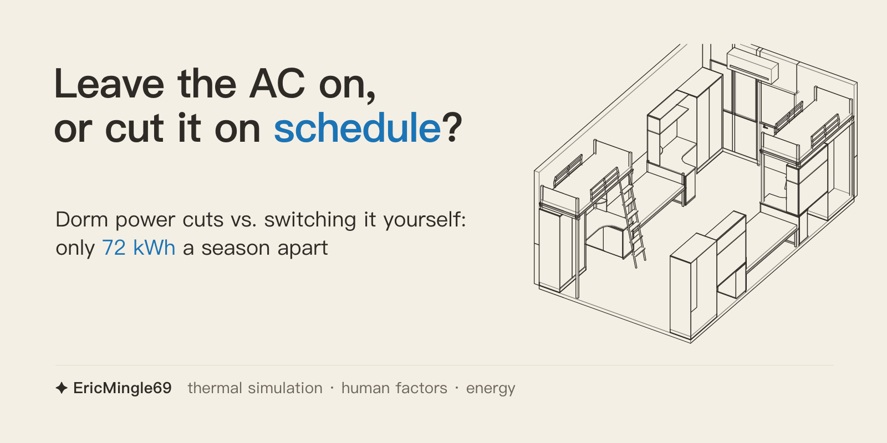
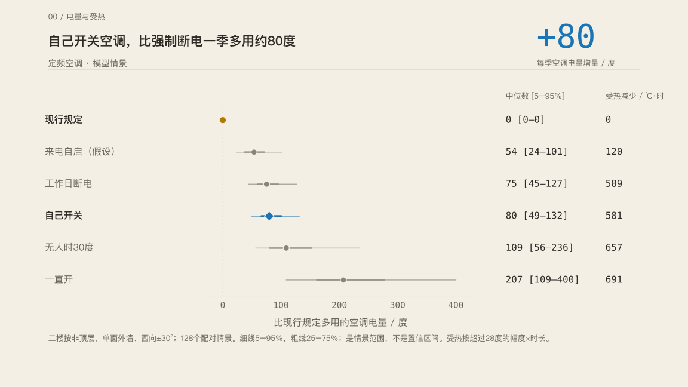
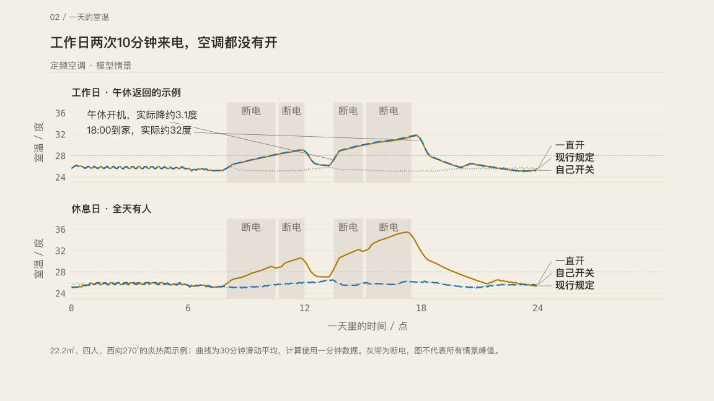
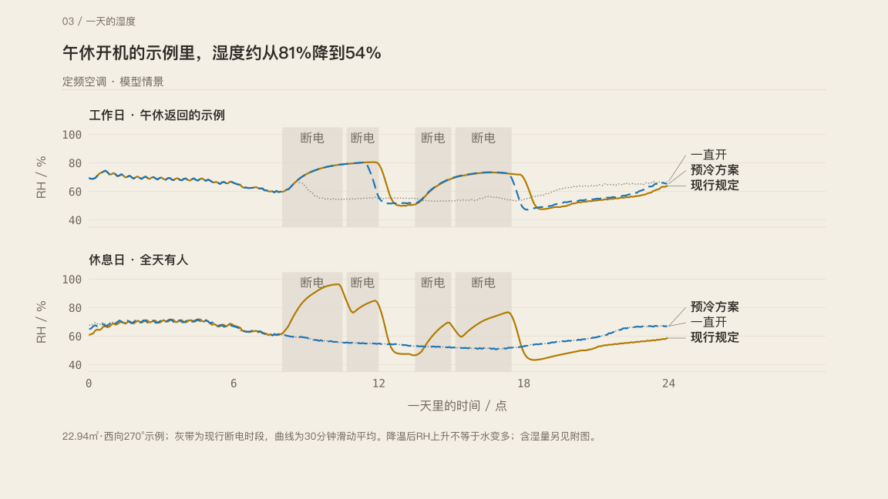

<picture>
  <source media="(prefers-color-scheme: dark)" srcset="readme-assets/cover-en-dark.png">
  
</picture>

<p align="center">
  <a href="模型与来源.md">Model &amp; sources (Chinese)</a> ·
  <a href="results/">Results data</a> ·
  <a href="figures/">All figures</a> ·
  <a href="https://github.com/Ming-Sir-69">Author</a>
</p>

<p align="center">
  <a href="LICENSE"></a>
  
  
  
  
  
</p>

<p align="center">
  <a href="README.md">简体中文</a> · <b>English</b>
</p>

Our factory dorm has a rule: power is cut whenever the work shift starts, weekends included, and comes back only at break time. I wanted the rule dropped. Saying "it's hot" got nowhere, so I did the sums: which uses more electricity, leaving the AC on or cutting it on schedule?

Honestly, it is a bit absurd. To get to use the air conditioner, I first had to run a study.

## Results

**On workdays, the scheduled cut and "switch it off when you leave" use almost the same energy; the extra use falls on rest days when people are in the room.**

- Fixed-speed unit: switching it yourself uses about **72 kWh** more per season than the scheduled cut (43–123), about 1.4 kWh per rest day. In return, people can keep the AC on during rest days instead of waiting for power.
- Inverter unit: about 56 kWh more per season (35–90).
- Workday difference: median 0.03 kWh/day, roughly zero; thermal storage across days and a little standby keep it from being exactly zero.

Basis: medians (5–95% scenario range), not measured confidence intervals; 128 paired parameter samples, west-facing ±30°, second floor not top, one exterior wall; three room sizes, two AC types and seven rules computed in pairs with shared occupancy calendars and weather.

<picture>
  <source media="(max-width: 600px) and (prefers-color-scheme: dark)" srcset="figures/00_主结论_暗_窄.svg">
  <source media="(max-width: 600px)" srcset="figures/00_主结论_亮_窄.svg">
  <source media="(prefers-color-scheme: dark)" srcset="figures/00_主结论_暗.svg">
  
</picture>

## How it was computed

- The room is rebuilt at its real size: 3.70 × 6.20 × 2.80 m, four people, two loft beds, two floor beds, four L-shaped desks, four double lockers; balcony facing west, 1.90 m² net glazing.
- Heat and moisture model: three thermal nodes (air; interior walls and furniture; exterior wall and roof) plus air humidity and coil water; one-minute integration driven by hourly weather.
- Real schedule: four power cuts a day; after power returns, the AC must be switched on by hand; nobody is in the room during the two 10-minute workday windows.
- Fixed-speed and inverter units, with minimum on/off times, part-load efficiency and dehumidification.
- Parameters, sources and which inputs are assumptions: [Model &amp; sources](模型与来源.md) (Chinese).

## Figures

Figure text is in Chinese; each title states its finding.

### Indoor temperature and humidity over a day

On workdays nobody is in during the short breaks, so the AC does not cool when power returns; it is switched on only when people come back at lunch. Curves are 30-minute moving averages; statistics use one-minute data.

<picture>
  <source media="(max-width: 600px) and (prefers-color-scheme: dark)" srcset="figures/02_一天室温_暗_窄.svg">
  <source media="(max-width: 600px)" srcset="figures/02_一天室温_亮_窄.svg">
  <source media="(prefers-color-scheme: dark)" srcset="figures/02_一天室温_暗.svg">
  
</picture>

<picture>
  <source media="(max-width: 600px) and (prefers-color-scheme: dark)" srcset="figures/03_一天湿度_暗_窄.svg">
  <source media="(max-width: 600px)" srcset="figures/03_一天湿度_亮_窄.svg">
  <source media="(prefers-color-scheme: dark)" srcset="figures/03_一天湿度_暗.svg">
  
</picture>

### What a rest day in the room is like

<picture>
  <source media="(max-width: 600px) and (prefers-color-scheme: dark)" srcset="figures/04_休息日_暗_窄.svg">
  <source media="(max-width: 600px)" srcset="figures/04_休息日_亮_窄.svg">
  <source media="(prefers-color-scheme: dark)" srcset="figures/04_休息日_暗.svg">
  
</picture>

### Trade-offs between rules

<picture>
  <source media="(max-width: 600px) and (prefers-color-scheme: dark)" srcset="figures/05_规则取舍_暗_窄.svg">
  <source media="(max-width: 600px)" srcset="figures/05_规则取舍_亮_窄.svg">
  <source media="(prefers-color-scheme: dark)" srcset="figures/05_规则取舍_暗.svg">
  
</picture>

### Which assumptions matter most

<picture>
  <source media="(max-width: 600px) and (prefers-color-scheme: dark)" srcset="figures/06_影响因素_暗_窄.svg">
  <source media="(max-width: 600px)" srcset="figures/06_影响因素_亮_窄.svg">
  <source media="(prefers-color-scheme: dark)" srcset="figures/06_影响因素_暗.svg">
  
</picture>

## Limitations

- No on-site energy or temperature/humidity calibration, and no cross-check against EnergyPlus or similar tools; the numbers are model scenarios with assumptions, not dorm measurements.
- Dimensions, glazing area, unit performance curves, window/door opening and return times are not measured; the number of storeys is unknown, so the second floor is treated as not the top floor.
- Fan comfort after power cuts, heat exchange with neighbouring rooms and sky long-wave radiation are not modelled.

## Run it yourself

Requires Python 3.12 and uv. From the repository root:

```sh
uv run --frozen python -m pytest -q
uv run --frozen python run_confirmed.py
uv run --frozen python verify_confirmed.py
uv run --frozen python render_figures.py --report
```

## Detailed data

The full tables (orientation and roof/corner comparisons, energy by rule, recovery in each power window, rest-day exposure, room-size comparison, cycling and sensitivity) are in the [Chinese README](README.md#详细数据), folded under 详细数据. Raw results are in `results/`.

## What is in the repository

| Path | Contents |
|---|---|
| `src/` | Heat-and-moisture and AC models |
| `run_confirmed.py`, `verify_confirmed.py` | Runs and checks for the final room |
| `results/` | Summary tables and minute-by-minute traces (`.csv.gz`) |
| `figures/` | All figures, light/dark and wide/narrow |
| `data/` | Original weather files, room evidence and parameters |
| `scene/` | Dorm scene rebuild (Blender), not used in the calculation |
| `模型与来源.md` | Parameters, sources and assumptions (Chinese) |

---

Maintained by **✦ EricMingle69** · [Ming-Sir-69](https://github.com/Ming-Sir-69)  
Code is released under the [MIT License](LICENSE); text and figures under [CC BY 4.0](https://creativecommons.org/licenses/by/4.0/); weather data keep their original licences.
