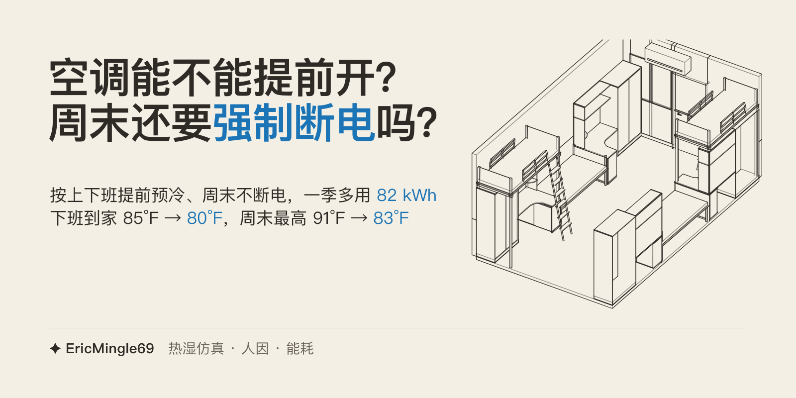
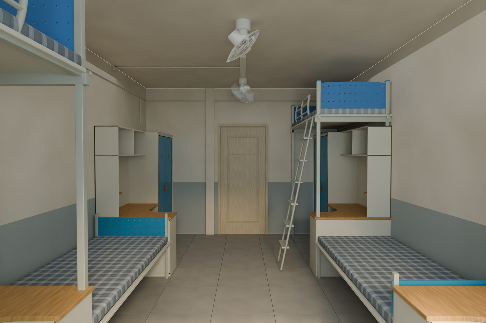
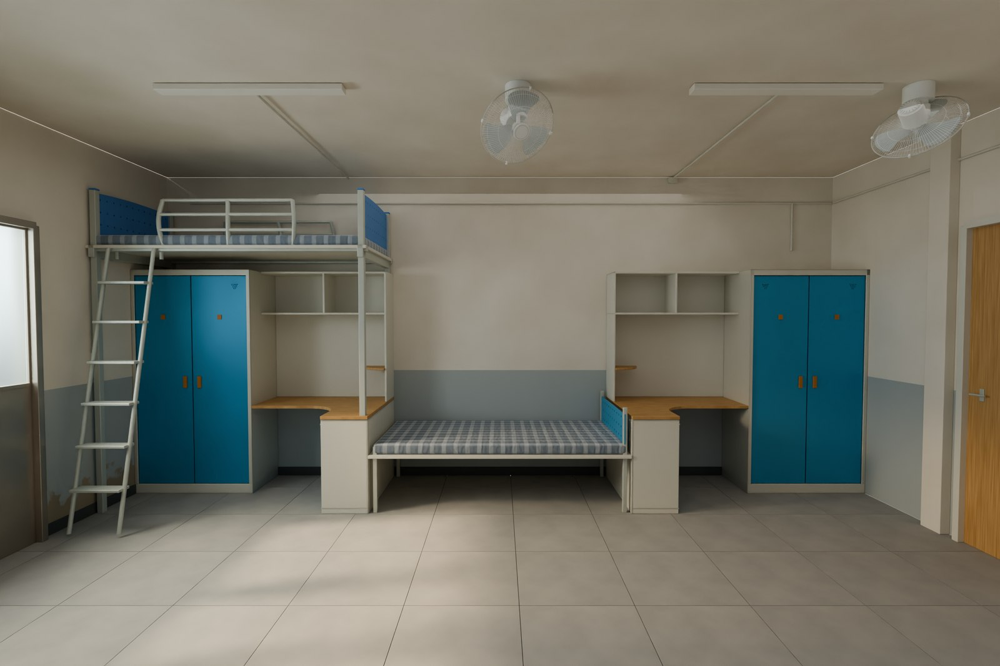
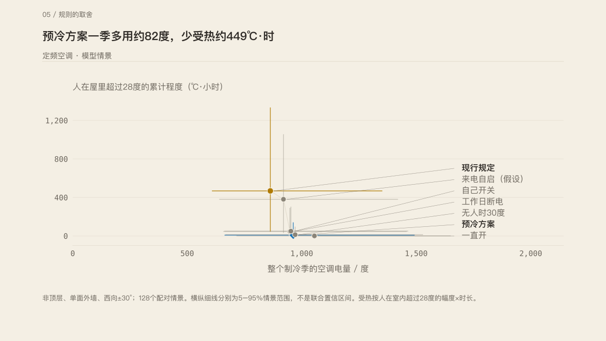
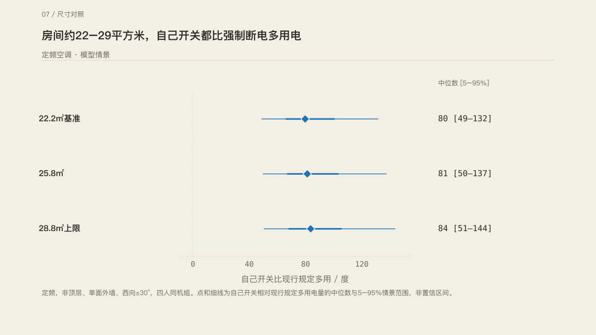

<picture>
  <source media="(prefers-color-scheme: dark)" srcset="readme-assets/cover-zh-dark.png">
  
</picture>

<p align="center">
  <a href="模型与来源.md">模型与来源</a> ·
  <a href="results/">结果数据</a> ·
  <a href="figures/">全部图表</a> ·
  <a href="https://github.com/Ming-Sir-69">作者主页</a>
</p>

<p align="center">
  <a href="LICENSE"></a>
  
  
  
  
  
</p>

<p align="center">
  <b>简体中文</b> · <a href="README.en.md">English</a>
</p>

# 宿舍空调：提前预冷、休息日供电与定时强制断电的能耗和室内热湿对比

本项目比较一间华南厂区四人宿舍的两种供电规则。现行规定在工作时段整间断电，休息日也按工作日时间执行，来电后空调需人到场手动开启；对照方案在工作日按上下班时间提前开机预冷，休息日不按工作日时间断电。项目采用三节点热网络加湿度节点的逐分钟模型，在 128 组配对参数情景下计算一个制冷季（184 天）的空调电量与室内温湿度。

## 主要结果

**两种规则的电量差主要来自休息日：工作日每天只多约 0.1 kWh，休息日每天多约 1.3 kWh；换来的是到家时和休息日在室时的室温明显下降。**

- 整季电量：预冷与休息日供电比现行规定多用 **82 kWh**（51–160，定频）；变频为 62 kWh（37–117）。
- 下班到家时室温：**85°F → 80°F**（29.4°C → 26.6°C）；降到 28°C 以下的中位时间由 29 分钟缩短到 4 分钟。
- 休息日在室时段的季内最高室温：**91°F → 83°F**（32.9°C → 28.2°C）。
- 在室热暴露（超过 28°C 的幅度乘时长）减少 449 °C·h（47–1253）。

统计口径：中位数（5–95% 情景范围），定频机组；情景为西向 ±30°、二层非顶层、单面外墙的 128 组配对参数样本，各规则共用人员日历与气象。预冷提前量基准 30 分钟，情景范围 10–60 分钟。区间反映参数不确定性，不是置信区间。

## 研究对象

房间净尺寸为 3.70×6.20×2.80 米，两端各为 2.10 米的桌柜与高架床单元，中段为 2.00 米落地床。两张高架床、两张落地床、四张 L 形桌和四只双门柜构成四人的蓄热体与在室热源；两扇磨砂窗与阳台门上半部合计 1.90 ㎡ 净玻璃，门下半部深色铝合金板及门窗框作为独立的不透明传热支路。


<details>
<summary><b>其他视角：阳台、左墙、右墙</b></summary>






</details>

## 方法

- 几何与构件：按上节的尺寸、家具与门窗建模，阳台朝西（270° ±30°）。
- 热湿模型：空气、内墙家具蓄热、外墙屋顶三个热节点，加空气含湿量和盘管存水；外表面热平衡参照 EnergyPlus 工程参考<sup>[[1]](#参考文献)</sup>，湿空气性质计算参照<sup>[[3]](#参考文献)[[10]](#参考文献)[[11]](#参考文献)</sup>；一分钟积分，逐时气象驱动<sup>[[4]](#参考文献)[[5]](#参考文献)</sup>，太阳位置按 NOAA 算法<sup>[[8]](#参考文献)</sup>。
- 现行规定：每天（含休息日）四段断电，08:00–10:30、10:40–12:00、13:30–15:00、15:10–17:30；来电后空调需手动开启，工作日两次 10 分钟供电时无人在室。
- 对照方案：工作日在午休返回和下班到家前提前开机预冷，08:00、13:30 离开时关机，两次短时来电不开机；休息日全天供电，在室时开机。
- 机组：定频与变频两类，含最短开停机时间、部分负荷效率与盘管除湿<sup>[[2]](#参考文献)</sup>。
- 围护结构表面换热与涂层太阳吸收率的取值范围参照 ASHRAE 手册与 EPA AP-42<sup>[[6]](#参考文献)[[7]](#参考文献)</sup>；参数取值、来源与假设范围见 [模型与来源](模型与来源.md)。
- 敏感性：Sobol 全局敏感性分析，Saltelli 抽样与 SALib 估计<sup>[[12]](#参考文献)[[13]](#参考文献)</sup>。

## 结果图

### 一天里的室温与湿度

工作日短时供电期间无人在室，空调未开启；午休返回后开启。曲线为 30 分钟滑动平均。

<picture>
  <source media="(max-width: 600px) and (prefers-color-scheme: dark)" srcset="figures/02_一天室温_暗_窄.svg">
  <source media="(max-width: 600px)" srcset="figures/02_一天室温_亮_窄.svg">
  <source media="(prefers-color-scheme: dark)" srcset="figures/02_一天室温_暗.svg">
  
</picture>

<picture>
  <source media="(max-width: 600px) and (prefers-color-scheme: dark)" srcset="figures/03_一天湿度_暗_窄.svg">
  <source media="(max-width: 600px)" srcset="figures/03_一天湿度_亮_窄.svg">
  <source media="(prefers-color-scheme: dark)" srcset="figures/03_一天湿度_暗.svg">
  
</picture>

### 休息日在室时段的室内温度

<picture>
  <source media="(max-width: 600px) and (prefers-color-scheme: dark)" srcset="figures/04_休息日_暗_窄.svg">
  <source media="(max-width: 600px)" srcset="figures/04_休息日_亮_窄.svg">
  <source media="(prefers-color-scheme: dark)" srcset="figures/04_休息日_暗.svg">
  
</picture>

### 各规则的电量与热暴露

<picture>
  <source media="(max-width: 600px) and (prefers-color-scheme: dark)" srcset="figures/05_规则取舍_暗_窄.svg">
  <source media="(max-width: 600px)" srcset="figures/05_规则取舍_亮_窄.svg">
  <source media="(prefers-color-scheme: dark)" srcset="figures/05_规则取舍_暗.svg">
  
</picture>

### 敏感性

<picture>
  <source media="(max-width: 600px) and (prefers-color-scheme: dark)" srcset="figures/06_影响因素_暗_窄.svg">
  <source media="(max-width: 600px)" srcset="figures/06_影响因素_亮_窄.svg">
  <source media="(prefers-color-scheme: dark)" srcset="figures/06_影响因素_暗.svg">
  
</picture>

<details>
<summary><b>附图：整季电量、房间对照、面积扫描、含湿量、变频机</b></summary>

<picture>
  <source media="(max-width: 600px) and (prefers-color-scheme: dark)" srcset="figures/01_电量_暗_窄.svg">
  <source media="(max-width: 600px)" srcset="figures/01_电量_亮_窄.svg">
  <source media="(prefers-color-scheme: dark)" srcset="figures/01_电量_暗.svg">
  
</picture>
<picture>
  <source media="(max-width: 600px) and (prefers-color-scheme: dark)" srcset="figures/07_房间对照_暗_窄.svg">
  <source media="(max-width: 600px)" srcset="figures/07_房间对照_亮_窄.svg">
  <source media="(prefers-color-scheme: dark)" srcset="figures/07_房间对照_暗.svg">
  
</picture>
<picture>
  <source media="(max-width: 600px) and (prefers-color-scheme: dark)" srcset="figures/附01_相图_暗_窄.svg">
  <source media="(max-width: 600px)" srcset="figures/附01_相图_亮_窄.svg">
  <source media="(prefers-color-scheme: dark)" srcset="figures/附01_相图_暗.svg">
  
</picture>
<picture>
  <source media="(max-width: 600px) and (prefers-color-scheme: dark)" srcset="figures/附02_含湿量_暗_窄.svg">
  <source media="(max-width: 600px)" srcset="figures/附02_含湿量_亮_窄.svg">
  <source media="(prefers-color-scheme: dark)" srcset="figures/附02_含湿量_暗.svg">
  
</picture>
<picture>
  <source media="(max-width: 600px) and (prefers-color-scheme: dark)" srcset="figures/附03_变频主结论_暗_窄.svg">
  <source media="(max-width: 600px)" srcset="figures/附03_变频主结论_亮_窄.svg">
  <source media="(prefers-color-scheme: dark)" srcset="figures/附03_变频主结论_暗.svg">
  
</picture>
<picture>
  <source media="(max-width: 600px) and (prefers-color-scheme: dark)" srcset="figures/附04_变频规则取舍_暗_窄.svg">
  <source media="(max-width: 600px)" srcset="figures/附04_变频规则取舍_亮_窄.svg">
  <source media="(prefers-color-scheme: dark)" srcset="figures/附04_变频规则取舍_暗.svg">
  
</picture>

</details>

## 局限

- 模型未经现场电量与温湿度实测校准，也未与 EnergyPlus 等工具对算；结果适用于所设边界条件。
- 换气率、楼层位置（按非顶层处理）和机组性能曲线为假设。敏感性分析中，电量增量对换气最敏感，其次为额定能效、墙体传热和预冷提前量。
- 顶层或转角房间的电量差显著更大，见“详细数据”中的对照表。

## 复现

环境：Python 3.12 与 uv。在仓库根目录运行：

```sh
uv run --frozen python -m pytest -q
uv run --frozen python run_confirmed.py
uv run --frozen python verify_confirmed.py
uv run --frozen python render_figures.py --report
```

场景重建、逐分钟轨迹与单独更新图表的命令见“详细数据 · 复现与待核实资料”。

## 详细数据

<details>
<summary><b>预冷与休息日供电：配对比较</b></summary>

工作日保留四段断电，但允许在午休返回前和下班到家前提前开机；午休不返回日不预冷，08:00和13:30关机。提前量基准30分钟、独立均匀情景10–60分钟。休息日沿用原在室日历、全天供电。原七规则保留为详细对照；定时开机功能是否可用尚未核实。

|指标|定频|变频|
|---|---|---|
|整季空调电量 kWh · 现行规定|862.8（609.5–1350.2）|750.6（511.0–1145.0）|
|整季空调电量 kWh · 预冷+休息日供电|962.9（664.5–1491.3）|815.3（556.3–1226.1）|
|整季空调电量 kWh · 预冷减现行|82.4（50.5–159.6）|62.4（37.2–116.5）|
|工作日日均 kWh · 现行规定|4.4（3.0–6.9）|3.8（2.6–5.8）|
|工作日日均 kWh · 预冷+休息日供电|4.5（3.0–7.1）|3.9（2.6–6.0）|
|工作日日均 kWh · 预冷减现行|0.11（0.01–0.34）|0.07（-0.01–0.22）|
|休息日日均 kWh · 现行规定|5.6（4.0–8.6）|4.8（3.5–7.3）|
|休息日日均 kWh · 预冷+休息日供电|7.0（5.0–10.9）|5.9（4.2–8.8）|
|休息日日均 kWh · 预冷减现行|1.31（0.74–2.31）|1.05（0.62–1.67）|
|在室热暴露 °C·h · 现行规定|481.9（47.2–1538.7）|511.3（74.0–1549.7）|
|在室热暴露 °C·h · 预冷+休息日供电|12.6（0.0–472.3）|0.6（0.0–173.9）|
|在室热暴露 °C·h · 预冷减现行|-448.8（-1253.0–-47.2）|-507.2（-1407.9–-73.9）|
|工作日到家时室温 °C · 现行规定|29.4（27.6–31.4）|29.5（27.8–31.5）|
|工作日到家时室温 °C · 预冷+休息日供电|26.6（25.0–28.4）|27.0（25.4–28.7）|
|工作日到家时室温 °C · 预冷减现行|-2.6（-4.3–-1.6）|-2.5（-4.1–-1.5）|
|到家后温度达标时间 min · 现行规定|29.2（2.0–360.0）|13.2（4.0–61.8）|
|到家后温度达标时间 min · 预冷+休息日供电|3.8（0.0–360.0）|0.0（0.0–31.3）|
|到家后温湿同时达标时间 min · 现行规定|35.8（15.0–360.0）|21.0（14.4–83.9）|
|到家后温湿同时达标时间 min · 预冷+休息日供电|18.8（0.0–360.0）|0.0（0.0–37.5）|
|休息日在室最高室温 °C · 现行规定|32.9（30.6–36.8）|33.1（30.6–37.0）|
|休息日在室最高室温 °C · 预冷+休息日供电|28.2（26.5–29.8）|27.2（25.7–28.7）|
|休息日在室最高室温 °F · 现行规定|91.1（87.0–98.2）|91.5（87.1–98.6）|
|休息日在室最高室温 °F · 预冷+休息日供电|82.8（79.6–85.6）|80.9（78.2–83.6）|
|预冷方案比自主开关多用 kWh|10.3（0.5–39.8）|6.2（-0.6–25.5）|

到家时室温先对每个情景季内工作日取平均。温度达标要求≤28°C连续30分钟；联合达标另要求RH≤65%。先取每个情景季内工作日恢复时间中位数，再给跨情景5–95%范围；未恢复日按六小时观察窗截尾，不能解释为保证达标时间。每条规则的在室日历相同。预冷方案仍保留其他工作日断电，而自主开关对照全天供电；两者还存在待机及背景电器散热差异，因此预冷相对自主开关的配对电量差在少量变频情景可为负，并非每个样本都增加。这里只计空调电量，背景电器散热作为室内热源处理。

</details>

<details>
<summary><b>数据表、口径与模型边界</b></summary>

主对照为按上下班时间提前开机预冷，并在休息日保留供电。工作日维持四段断电，午休返回日和下班到家前提前开机；无人短休不开。预冷提前量基准30分钟、情景10–60分钟，温度设定与在室相同。

- 定频：现行规定相对一直开节电 17.4（10.5–23.3）%；改成预冷+休息日供电，整季相对现行规定多用 82（51–160） kWh。
- 变频：现行规定相对一直开节电 16.4（10.5–21.2）%；改成预冷+休息日供电，整季相对现行规定多用 62（37–117） kWh。

**工作日两次10分钟供电时无人，空调不会自己开，因此没有空调制冷恢复。** 现行规定在午休和下班返回后手动开；预冷方案按返回日历提前定时开机。提前供电且仍手动是另一条规则，不等于预冷。

</details>

<details>
<summary><b>已确认与仍在假设的条件</b></summary>

- 实际四人间、住4人。家具是两张高架床、两张落地床、四张L形桌、四只双门铁柜。房间工作尺寸约3.7×6.2×2.8米，依据过道横向三块砖加两排家具、家具占满长墙及口述，仍非实测；净宽3.6–4.4、净长6.0–6.4、净高2.6–3.2米作为情景范围。床长约占3.3格，场景判读地砖更可能0.6米，把握中低，仍未实测。0.8米砖的4.3×6.2米及口述上限4.8×6.2米另列对照。
- 每天含休息日均按四段断电：08:00–10:30、10:40–12:00、13:30–15:00、15:10–17:30。其间供电10、90、10分钟；17:30至次日08:00持续供电。断电时包括壁挂风扇在内的全部用电设备停转；这不等于门窗漏风或自然换气为零。
- 来电后空调必须手动重新打开。工作日两次短休无人，不开机；午休返回概率基准0.5、情景0–1，固定随机日历共享。返回日假设12:00后5分钟抵达（范围0–15分钟）；下班后30分钟抵达，即基准18:00（延迟范围0–60分钟）。到家或休息日来电后，再等1分钟手动开机（范围0–5分钟）。返回日按4人同时回来简化，实际可能只有部分人回。
- 阳台外墙有两扇磨砂窗及半玻璃半铝合金门。两窗净玻璃各0.495×1.085米，门上半净玻璃0.830×0.9975米，净玻璃合计1.902075㎡；1.6–2.4㎡作为照片推算与遮框误差的情景范围，非测量置信区间。门下半古铜棕横向压纹不透明铝合金板按0.945㎡、框按0.4638375㎡单列，均不透射太阳辐射；框不再叠加算成玻璃。深色铝合金板及混合门窗框的传热、太阳吸收是未测假设，范围见方法和参数表。已确认二楼、非转角、阳台朝西，方位270°±30°；两侧长墙邻室，另一端走廊，总层数未知，二楼按非顶层处理。下午两段断电与西晒重合，中间15:00只有10分钟供电。
- 四套家具有效热容暂取0.5 MJ/K、范围0.2–1.0 MJ/K，质量未测，未采用未经测量的精确质量。内墙地顶有效热容按面积密度缩放：约130 kJ/(㎡·K)，情景52–313 kJ/(㎡·K)；物性按面积密度给定；家具热容不再乘四，也不随房间面积重复放大。
- 基准空调制冷量3500 W，情景2600–5000 W，机型与性能均未核；所有房间对照使用相同机组参数。气象为深圳SWERA与广州CSWD典型年，各64个参数样本（默认共128），不是实际厂区天气。广州原始RH有38小时为101%，保留原文件，换算时按100%并保存清单。

</details>

<details>
<summary><b>朝向、顶层和转角分开看</b></summary>

二楼、非转角、阳台朝西已确认；总层数未知，非顶层仍为假设。方位为270°±30°。四种工况共用完全相同的128组其他输入、气象和人员日历，朝东只把方位旋转180°，顶层只增加暴露屋面，转角只增加侧外墙及其派生蓄热。三种对照均不是本宿舍已确认状态。

|建筑工况|空调|样本数|现行相对一直开节电 %|预冷方案整季多用 kWh|工作日日均多用 kWh|休息日日均多用 kWh|现行休息日季内最高温 °C|
|---|---|---|---|---|---|---|---|
|二楼西向·单面外墙（基准）|定频|128|17.4（10.5–23.3）|82（51–160）|0.11（0.01–0.34）|1.31（0.74–2.31）|32.9（30.6–36.8）|
|二楼西向·单面外墙（基准）|变频|128|16.4（10.5–21.2）|62（37–117）|0.07（-0.01–0.22）|1.05（0.62–1.67）|33.1（30.6–37.0）|
|朝东对照·非顶层单面外墙|定频|128|17.4（9.9–23.8）|80（48–158）|0.10（0.01–0.35）|1.29（0.70–2.28）|31.4（29.2–35.2）|
|朝东对照·非顶层单面外墙|变频|128|16.7（11.0–22.1）|61（36–112）|0.07（-0.01–0.24）|1.03（0.60–1.66）|31.6（29.6–35.3）|
|顶层对照·西向单面外墙|定频|128|25.3（16.0–34.4）|142（86–280）|0.18（0.01–0.69）|2.29（1.37–4.01）|37.3（32.6–43.1）|
|顶层对照·西向单面外墙|变频|128|21.7（12.0–32.5）|106（60–251）|0.14（0.01–0.64）|1.75（0.91–3.32）|37.3（32.6–43.1）|
|转角对照·非顶层西向|定频|128|22.5（13.9–30.3）|113（69–226）|0.16（0.01–0.54）|1.82（1.05–3.18）|34.1（31.1–38.5）|
|转角对照·非顶层西向|变频|128|18.7（12.0–26.4）|79（48–172）|0.10（0.01–0.44）|1.29（0.77–2.31）|34.3（31.3–38.6）|

下面直接比较同一样本的建筑工况差值；正数表示对照工况比西向基准更高，范围不是两列分位数相减。

|相对西向基准|空调|现行整季电量变化 kWh|预冷方案额外用电变化 kWh|现行休息日峰温变化 °C|
|---|---|---|---|---|
|朝东对照·非顶层单面外墙|定频|-13（-29–10）|-2（-5–1）|-1.4（-2.9–-0.5）|
|朝东对照·非顶层单面外墙|变频|-15（-33–7）|-1（-4–2）|-1.3（-2.8–-0.5）|
|顶层对照·西向单面外墙|定频|229（125–452）|58（26–135）|4.5（1.4–7.0）|
|顶层对照·西向单面外墙|变频|247（127–471）|43（7–137）|4.3（1.5–7.0）|
|转角对照·非顶层西向|定频|86（22–222）|30（13–66）|1.1（0.3–2.1）|
|转角对照·非顶层西向|变频|94（23–221）|15（4–60）|1.1（0.3–2.1）|

未另注明的季节图表都使用西向基准128组。完整数据见 `results/building_confirmed.csv.gz`；本报告只使用定稿房间的当前计算结果。

</details>

<details>
<summary><b>电量：一直开、现行规定、预冷+休息日供电</b></summary>

制冷季假设五月至十月连续184天，起始星期一；不从典型年拼接年份推断真实星期。单日电量是季内工作日平均，整季含休息日；只计空调，不含风扇等其他电器电量。下表使用二楼按非顶层、单面外墙、西向±30°的128个配对样本（两站各64组），对应主房间的尺寸包络（21.60–28.16㎡），不是只固定22.94㎡的结果；时间曲线和确定算例另用22.94㎡基准。均匀抽样是试算选择，不把“地砖更可能0.6米”强行量化为概率。

|空调|一直开：工作日日均 kWh|现行规定：工作日日均 kWh|一直开：整季 kWh|现行规定：整季 kWh|节电比例 %|
|---|---|---|---|---|---|
|定频|5.3（3.5–8.3）|4.4（3.0–6.9）|1055（717–1649）|863（610–1350）|17.4（10.5–23.3）|
|变频|4.6（3.1–6.9）|3.8（2.6–5.8）|906（621–1360）|751（511–1145）|16.4（10.5–21.2）|

|空调|现行规定整季 kWh|预冷+休息日供电整季 kWh|预冷+休息日供电比现行规定多用 kWh|来电自启假设整季 kWh|
|---|---|---|---|---|
|定频|863（610–1350）|963（664–1491）|82（51–160）|920（641–1419）|
|变频|751（511–1145）|815（556–1226）|62（37–117）|783（535–1190）|

差值按同一情景配对计算，中位数分别统计，不一定等于两列中位数相减。来电自启只是功能相反的假想对照，不是本人机组的真实行为；其人员日历不变。

</details>

<details>
<summary><b>两次10分钟、午休90分钟究竟能恢复多少</b></summary>

温差为供电前温度减去窗口结束温度，正数是降温、负数是升温。RH受温度与水量共同影响；含湿量下降才表示空气里的水蒸气减少。每个情景先对季内同类日取平均，再跨情景给范围。

|日型|空调|供电窗口|开始室温 °C|结束室温 °C|降温 °C|开始RH %|结束RH %|含湿量下降 g/kg|
|---|---|---|---|---|---|---|---|---|
|工作日全部|定频|10:30–10:40|27.3（25.8–28.3）|27.4（25.9–28.4）|-0.1（-0.1–-0.0）|76.6（69.7–84.2）|76.3（69.8–84.0）|-0.0（-0.1–0.0）|
|工作日全部|定频|12:00–13:30|27.9（26.2–28.9）|27.3（25.4–28.9）|0.3（-0.5–1.9）|75.6（69.6–83.0）|62.1（49.4–73.0）|3.7（0.5–7.2）|
|工作日全部|定频|15:00–15:10|28.7（27.0–30.4）|28.8（27.1–30.6）|-0.1（-0.2–-0.0）|68.7（59.1–76.0）|68.7（59.5–76.2）|-0.1（-0.3–-0.1）|
|工作日全部|变频|10:30–10:40|27.4（25.9–28.4）|27.5（25.9–28.5）|-0.1（-0.1–-0.1）|76.5（69.3–84.1）|76.2（69.4–83.9）|-0.0（-0.1–0.0）|
|工作日全部|变频|12:00–13:30|28.0（26.3–29.1）|27.5（25.9–29.1）|0.3（-0.6–1.6）|75.4（69.2–82.8）|61.6（50.2–72.6）|3.6（0.6–7.2）|
|工作日全部|变频|15:00–15:10|28.9（27.1–30.6）|29.0（27.2–30.8）|-0.1（-0.2–-0.0）|68.3（59.0–75.6）|68.2（59.7–75.8）|-0.1（-0.3–-0.1）|
|仅午休返回日|定频|12:00–13:30|27.8（26.2–28.8）|26.2（24.7–27.6）|1.5（0.6–2.8）|76.1（70.1–83.2）|53.7（46.5–59.9）|6.5（5.1–8.2）|
|仅午休返回日|变频|12:00–13:30|27.9（26.2–29.0）|26.6（25.2–27.8）|1.2（0.5–2.1）|75.7（69.5–83.1）|53.7（45.9–59.6）|6.5（4.9–7.9）|
|休息日|定频|10:30–10:40|28.3（26.7–29.4）|26.8（25.2–28.0）|1.3（0.9–2.3）|89.4（81.4–96.0）|80.6（71.8–89.9）|3.8（2.2–5.0）|
|休息日|定频|12:00–13:30|29.0（27.2–30.6）|26.5（24.7–27.9）|2.3（1.5–3.8）|84.7（76.1–94.2）|49.7（44.1–57.0）|10.4（8.3–13.5）|
|休息日|定频|15:00–15:10|29.4（27.5–31.6）|27.3（25.8–29.2）|1.9（1.0–3.1）|73.9（65.5–81.7）|68.4（62.7–76.3）|3.3（1.7–4.6）|
|休息日|变频|10:30–10:40|28.3（26.8–29.7）|27.5（26.1–28.7）|0.7（0.4–1.3）|89.0（80.3–95.6）|85.9（77.5–93.4）|1.7（0.8–2.9）|
|休息日|变频|12:00–13:30|29.1（27.4–30.8）|26.6（25.2–27.9）|2.3（1.4–3.8）|86.5（75.9–96.2）|49.5（43.4–56.5）|11.0（8.6–14.8）|
|休息日|变频|15:00–15:10|29.6（27.8–31.7）|28.2（26.7–30.0）|1.3（0.7–2.2）|73.3（64.5–81.1）|71.5（64.7–79.0）|1.7（0.9–3.1）|

工作日全部平均包含无人返回、不启动空调的午休；返回日另列，避免把两者混淆。极低返回概率情景若没有返回日，其条件统计不适用，但仍保留在全季电量和全部工作日统计中。两次10分钟的工作日温湿变化来自自然热湿交换与残余回蒸，不是空调制冷。

|空调|窗口|现行规定结束室温 °C|假设自启结束室温 °C|现行规定结束RH %|假设自启结束RH %|
|---|---|---|---|---|---|
|定频|10:30–10:40|27.4（25.9–28.4）|26.3（24.9–27.7）|76.3（69.8–84.0）|70.3（63.9–77.0）|
|定频|15:00–15:10|28.8（27.1–30.6）|26.5（25.0–27.8）|68.7（59.5–76.2）|62.4（52.8–68.4）|
|变频|10:30–10:40|27.5（25.9–28.5）|26.7（25.5–27.9）|76.2（69.4–83.9）|73.4（68.1–80.6）|
|变频|15:00–15:10|29.0（27.2–30.8）|27.2（25.8–28.3）|68.2（59.7–75.8）|64.6（54.8–71.4）|

10分钟不足以证明连续30分钟舒适；午休13:30后仍会再次断电。逐日窗口前后状态、在室标志、冷凝、排水、回蒸和电量在 `results/west_window_daily.csv.gz`。

</details>

<details>
<summary><b>下班到家后，多久凉下来、多久温湿同时合适</b></summary>

从实际到家时刻计时，已包含到家后开机反应；不把无人时从17:30送电到回家的延迟说成人在室内等待。温度条件为不高于28°C并持续30分钟；联合条件再要求RH≤65%。均为计算阈值，未含风速、辐射温度、空气质量及个人感受。

|空调|17:30送电时室温 °C|到家时室温 °C|到家RH %|到家热指数<sup>[[9]](#参考文献)</sup> °C|30分钟仍未温度达标 %|90分钟仍未温度达标 %|90分钟仍未联合达标 %|六小时仍未联合达标 %|
|---|---|---|---|---|---|---|---|---|
|定频|29.4（27.6–31.3）|29.4（27.6–31.4）|70.1（61.9–77.2）|33.9（30.8–36.9）|48.9（0.0–95.9）|18.9（0.0–94.4）|25.8（2.3–96.2）|6.8（0.0–94.2）|
|变频|29.4（27.7–31.4）|29.5（27.8–31.5）|69.4（61.8–76.6）|34.1（31.1–37.2）|8.0（0.0–71.1）|0.0（0.0–40.8）|5.3（0.0–47.0）|2.3（0.0–12.6）|

不把六小时封顶中位数当成保证恢复时刻。连续30分钟的要求较严格，温控启停略微反复越线也会使其不达标，不表示整个观察期都处在高温高湿。原始逐日恢复事件和截尾标志在 `results/west_recovery_daily.csv.gz`；数据仍保存温度与联合恢复两列，主要阅读上表未达标比例。一直开也可能有高湿或容量不足，不能把现行规定的全部等待都归因于断电。

</details>

<details>
<summary><b>休息日有人，却仍然断电</b></summary>

|空调|断电时段平均室温 °C|同一时段平均RH %|季内休息日最高室温 °C|休息日>28°C小时数|休息日RH>65%小时数|休息日日均节电 kWh|
|---|---|---|---|---|---|---|
|定频|28.7（27.0–30.3）|75.9（69.6–82.0）|32.9（30.6–36.8）|327（68–927）|695（421–851）|1.3（0.7–2.3）|
|变频|28.9（27.3–30.4）|77.0（69.8–83.2）|33.1（30.6–37.0）|338（96–592）|627（368–807）|1.0（0.6–1.6）|

最高温是季内休息日的最高值，不是日均。断电时壁挂风扇和其他通风设备也停止，因此实际体验还少了吹风；模型没有计算风速体感，不能据此精确评估床位舒适。漏风和自然换气仍保留假设，不写成零通风。

</details>

<details>
<summary><b>替代规则的取舍</b></summary>

图中将“提前供电·仍需手动”合并到“仅工作日断电”展示，详细表仍列出全部八条规则：工作日11:00、16:30提前来电时仍无人，不会预冷；两条规则都在休息日持续供电。两者的制冷可用时段相同，微小电量差来自额外通电期间的待机与其他电器热源；完整原始八规则仍保留在数据表。无人时30°C属于设备支持温控管理的条件对照，尚未核实本机有此功能。

|空调|规则|整季电量 kWh|相对一直开节电 %|新增有人热暴露 °C·h|有人RH>65%小时数|
|---|---|---|---|---|---|
|定频|一直开|1055（717–1649）|0.0（0.0–0.0）|0（0–0）|1955（802–2468）|
|定频|现行规定·手动开机|863（610–1350）|17.4（10.5–23.3）|468（47–1330）|1652（746–2162）|
|定频|仅工作日断电|948（659–1457）|11.0（5.6–15.6）|46（3–287）|1540（603–2191）|
|定频|无人时调至30°C|971（669–1528）|8.3（4.3–12.1）|13（0–92）|1575（606–2188）|
|定频|自主开关·全程供电|953（664–1463）|10.5（4.9–15.2）|49（3–300）|1529（596–2178）|
|定频|来电自启·假设对照|920（641–1419）|12.4（7.8–18.0）|381（34–1052）|1733（868–2292）|
|定频|提前供电·仍需手动|950（660–1459）|10.9（5.4–15.5）|47（3–291）|1537（601–2186）|
|定频|预冷+休息日供电|963（664–1491）|9.2（4.1–13.6）|8（0–137）|1596（615–2213）|
|变频|一直开|906（621–1360）|0.0（0.0–0.0）|0（0–0）|1653（333–2418）|
|变频|现行规定·手动开机|751（511–1145）|16.4（10.5–21.2）|507（74–1445）|1419（533–2070）|
|变频|仅工作日断电|802（549–1218）|10.5（6.0–14.3）|38（4–281）|1296（232–2039）|
|变频|无人时调至30°C|832（566–1228）|8.4（5.1–11.6）|12（0–62）|1299（225–2054）|
|变频|自主开关·全程供电|807（553–1224）|9.8（5.3–14.0）|40（4–296）|1287（230–2025）|
|变频|来电自启·假设对照|783（535–1190）|12.8（9.3–16.4）|432（57–1173）|1453（519–2190）|
|变频|提前供电·仍需手动|803（550–1219）|10.3（5.8–14.2）|39（4–285）|1293（231–2035）|
|变频|预冷+休息日供电|815（556–1226）|9.0（5.1–13.0）|0（-22–115）|1331（233–2063）|

热暴露为有人时超过28°C的幅度乘时长，不含风速和过冷代价。高温与高湿小时可能重叠，不能相加。RH小时也不能单独排名：更热的空气本身会压低RH读数，即使水分没有减少，较少RH超标小时也不表示更舒适。

</details>

<details>
<summary><b>尺寸对照</b></summary>

三个房间均为四人、同一套家具数量和同一台空调参数。主房间按尺寸范围抽样，0.8米砖与口述上限对照固定长宽，层高、门窗和机组等共用配对参数。不是三间实测宿舍，也不是面积纯因果效应。

|房间|空调|现行规定整季电量 kWh|相对一直开节电 %|休息日最高室温 °C|六小时未联合达标 %|
|---|---|---|---|---|---|
|约22.94㎡（3.7×6.2米）|定频|863（610–1350）|17.4（10.5–23.3）|32.9（30.6–36.8）|6.8（0.0–94.2）|
|约22.94㎡（3.7×6.2米）|变频|751（511–1145）|16.4（10.5–21.2）|33.1（30.6–37.0）|2.3（0.0–12.6）|
|0.8米砖对照26.66㎡（4.3×6.2米）|定频|871（617–1363）|17.7（10.6–24.1）|32.6（30.4–36.6）|6.8（0.0–93.2）|
|0.8米砖对照26.66㎡（4.3×6.2米）|变频|762（519–1180）|16.1（10.1–21.2）|32.8（30.4–36.6）|2.7（0.0–12.9）|
|口述上限29.76㎡（4.8×6.2米）|定频|892（623–1410）|18.1（10.8–24.7）|32.4（30.1–36.3）|6.8（0.0–91.6）|
|口述上限29.76㎡（4.8×6.2米）|变频|794（530–1244）|16.0（9.9–21.4）|32.5（30.0–36.4）|3.0（0.0–15.6）|

精确工作尺寸的基准结果见 `results/west_room_comparison.csv`。墙窗传热、屋面、室内蓄热与空调单位面积能力都会一起改变，不只改变空气体积。

</details>

<details>
<summary><b>启停与折算效率</b></summary>

折算效率为整季实际输出冷量/空调总电量，含风机和待机，不是能效标签；未把两类机组的差距拟合到预设比例。

|空调|一直开：每天启动|现行规定：每天启动|一直开：折算效率|现行规定：折算效率|
|---|---|---|---|---|
|定频|77.5（52.2–110.9）|53.5（40.0–76.1）|3.82（2.81–4.84）|4.00（2.91–5.06）|
|变频|2.6（0.2–37.4）|3.2（2.1–20.3）|4.50（3.40–5.50）|4.63（3.49–5.71）|

</details>

<details>
<summary><b>启停次数为什么不能当实机预测</b></summary>

最短开机时间180–600秒、最短停机时间120–300秒分别做3档，两站共54条定频整季轨迹；其余参数固定为22.94㎡、非顶层、单面外墙、朝西270°的默认值。它是额外确定参数扫描，没有并入主情景区间。下表停机时间固定180秒；完整9组合见 `results/west_cycle_timer_scan.csv`。

|气象|最短开机 分钟|一直开每天启动|现行每天启动|一直开开机段10–90% 分钟|现行相对一直开节电 %|自主开关多用 kWh/季|
|---|---|---|---|---|---|---|
|shenzhen|3|142.5|82.4|3.0–3.0|18.4|79|
|shenzhen|5|87.2|52.8|5.0–5.0|17.3|73|
|shenzhen|10|44.7|28.9|10.0–10.0|16.3|67|
|guangzhou|3|130.1|78.5|3.0–3.0|17.6|73|
|guangzhou|5|80.3|50.2|5.0–5.0|16.6|68|
|guangzhou|10|41.5|27.5|10.0–10.0|15.5|62|

开机段按一分钟输出连续运行段统计，剔除边界截断段，保留强制断电中断。基准很多开机段贴着最短时间，时间加倍会显著减少启动次数；节电率的变化需看同站同组合，不能把每天启动数当作现场预测。该扫描已按西向270°更新；以表中的同站5分钟和10分钟两行判断启动数与节电率如何变化。

</details>

<details>
<summary><b>哪些条件更影响结果</b></summary>

仅针对深圳站一个炎热周、主房间及规定时段，以512对基础样本和27个输入做全局敏感性分析；不代表整季名次。该扫描固定非顶层、单面外墙，方位限制为西向±30°，不再把顶层/转角当未知开关。指数大小仍依赖27个未定输入的所选范围。输出为预冷方案减现行的用电增量、现行减预冷的在室热暴露。输入含预冷提前量、返回和手动反应延迟，已知人数不再抽样。总效应包含交互，不加总成百分比，区间是配对重采样95%范围。

- 定频预冷用电增量：换气 0.43（0.38–0.51）、额定能效 0.26（0.22–0.30）、墙体传热 0.05（0.05–0.06）。
- 定频减少的热暴露：建筑内蓄热 0.49（0.41–0.57）、设定温度 0.19（0.17–0.22）、制冷能力 0.13（0.10–0.17）。
- 变频预冷用电增量：换气 0.49（0.41–0.58）、制冷能力 0.16（0.13–0.21）、额定能效 0.15（0.13–0.18）。
- 变频减少的热暴露：建筑内蓄热 0.45（0.37–0.53）、设定温度 0.19（0.17–0.23）、制冷能力 0.13（0.10–0.16）。
- 定频预冷提前量10–60分钟：用电增量 总效应 0.048（0.040–0.056）；减少热暴露 总效应 0.001（0.001–0.002）。
- 变频预冷提前量10–60分钟：用电增量 总效应 0.029（0.024–0.034）；减少热暴露 总效应 0.001（0.001–0.002）。

区间重叠时不强调精确排名。主相图固定四人、相同门窗与机组，按固定断电与手动行为扫描面积及墙体传热；不以单段时长替代规定。

</details>

<details>
<summary><b>方法、核对与局限</b></summary>

- 空气、内墙家具蓄热体、外墙屋顶合并节点，共三个热节点；另有空气含湿量和盘管存水状态。一分钟积分，逐时气象驱动，人员与设备热源随在室和供电变化。
- 定频最短开机基准300秒、核对范围180–600秒，最短停机180秒、核对范围120–300秒；另做两站整季3×3时间组合扫描。这两项未加入原全局抽样，启动次数是计时器与控制假设的产物，不能当作实机预测；启动爬升基准45秒、范围15–90秒。变频有部分负荷效率和容量约束；两类曲线是假设，未有厂家校准。电量按实际可用容量和效率计算，未把空气侧上限再算成额外损耗。
- 除湿按进风温湿度、有效盘管露点、风量与旁通比例动态分配显潜热，记录盘管存水、排水和停机回蒸；另扫盘管温度/风量/存水量。盘管露点在每条轨迹内固定（基准12°C），不随变频转速改变，可能高估低速除湿。仍没有独立湿控、材料吸湿、湿盘管完整厂家曲线或床位空间差异，不能保证主观不闷。
- 内置热水余额只是离散自检。`audit.py`在一个炎热周内、无预热且初态已知时，另从输入气象与保存状态做热、水后处理记账；冷量与运行比例仍读自模拟输出，电量是按同一功率公式重算。篡改输出的测试能检出部分差错，但没有独立求解控制与盘管，也不是整季或实测验证。证据见 `results/west_independent_budgets.csv`。
- 一节点指数解、三节点矩阵指数解、湿量混合解析解及步长/预热/收尾/气象替换检查均有记录。五分钟显式步长在紧凑主房间不稳定，已拒绝，不列作物理结果；主结果用一分钟。**没有运行EnergyPlus对算，没有现场温湿度与电量验证。** 两周电费较低的回忆最多说方向一致。
- 外墙有效蓄热只相当于约36毫米混凝土，并非实际墙厚；屋面与墙共用U值和一个节点，可能夸大顶层高温，尤其高温尾部，不能把高温尾部当现场预测。无阳台挑檐遮阳，人体显热/潜热各为常数、不随室温调整。相邻房间热交换、门窗实际开合、天空长波、风扇体感未模拟；风机热未单独反馈室内。门窗默认关闭，换气是假设。若阳台门经常开着，需另算换气工况。
- 参数范围、来源、固定与派生方式见 `data/confirmed_parameters.csv`；详见 [模型与来源](模型与来源.md)。家具材料质量尚未核实，不能拿场景概念图当作精确热模型或气流仿真。

</details>

<details>
<summary><b>复现与待核实资料</b></summary>

逐分钟曲线以无损压缩的 `.csv.gz` 保存，读取后的数值不变。公开包保留定稿房间的完整汇总结果与西向逐分钟轨迹；广朝向的逐分钟轨迹可选生成，不随包提供。如需生成广朝向轨迹，运行 `uv run --frozen python run.py --traces-only`。

在本目录运行，需Python 3.12与uv，按锁文件安装依赖；原始气象和哈希已保存。

```sh
uv run --frozen python -m pytest -q
uv run --frozen python run_confirmed.py
uv run --frozen python verify_confirmed.py
uv run --frozen python render_figures.py --report
```

场景重建需要Blender 4.2 LTS，已用4.2.23验证。运行 `blender --background --factory-startup --python scene/source/build_model.py` 可生成场景；五个视角的渲染和JPG压缩命令见 [场景说明](scene/README.md)。场景图不参与热计算。

只更新图表、不运行仿真时，可运行 `uv run --frozen python render_figures.py --report`。图表需系统苹方SC、Noto Sans SC或思源黑体之一；图件使用苹方SC，导出的SVG已转曲，阅读图件不依赖字体安装。

默认128个共用参数样本。西向主基准三种房间×两类机组×八条规则，共6144条整季轨迹；朝东/顶层/转角各在主房间计算一直开、现行、自主开关和预冷方案，共3072条对照，总计9216条。Sobol基础样本512对、27个输入。随机种子固定，执行测试、数据、八张核心图及四张补充图和本文生成；每张有亮暗、宽窄四版PNG与SVG。

二楼、非转角、阳台朝西已经确认；总层数未知，非顶层仍是明确假设。方位精度、净尺寸与层高、玻璃面积、门窗开合、机组曲线和返回延迟仍非实测，是结果的未解决局限；将来有实测温湿度和分项电量后才能进一步校准。

</details>

## 致谢

- 气象数据：EnergyPlus 气象文件库提供的深圳 SWERA 与广州 CSWD 典型年数据<sup>[[4]](#参考文献)[[5]](#参考文献)</sup>。
- 开源软件：NumPy、SciPy、pandas、Matplotlib、Numba、pytest、uv；场景建模使用 Blender。
- 方法实现参考：EnergyPlus 工程文档、PsychroLib、SALib。

## 参考文献

1. U.S. Department of Energy. *EnergyPlus Engineering Reference*, v25.1: Outside Surface Heat Balance. <https://bigladdersoftware.com/epx/docs/25-1/engineering-reference/outside-surface-heat-balance.html>
2. U.S. Department of Energy. *EnergyPlus Engineering Reference*, v25.1: Coils. <https://bigladdersoftware.com/epx/docs/25-1/engineering-reference/coils.html>
3. U.S. Department of Energy. *EnergyPlus Module Developer Guide*, v25.1: Psychrometric Services. <https://bigladdersoftware.com/epx/docs/25-1/module-developer/psychrometric-services.html>
4. EnergyPlus Weather Data. Shenzhen 594930, SWERA. <https://energyplus-weather.s3.amazonaws.com/asia_wmo_region_2/CHN/CHN_Guangdong.Shenzhen.594930_SWERA/CHN_Guangdong.Shenzhen.594930_SWERA.epw>
5. EnergyPlus Weather Data. Guangzhou 592870, CSWD. <https://energyplus-weather.s3.amazonaws.com/asia_wmo_region_2/CHN/CHN_Guangdong.Guangzhou.592870_CSWD/CHN_Guangdong.Guangzhou.592870_CSWD.epw>
6. ASHRAE. *ASHRAE Handbook—Fundamentals* (SI), Chapter 26: Heat, Air, and Moisture Control in Building Assemblies—Material Properties. <https://handbook.ashrae.org/Handbooks/F25/SI/F25_Ch26/F25_Ch26_si.aspx>
7. U.S. EPA. *AP-42*, Chapter 7.1: Organic Liquid Storage Tanks, Table 7.1-6 (paint solar absorptance). <https://www.epa.gov/system/files/documents/2024-10/c7s1_2024final_rlso.pdf>
8. NOAA Global Monitoring Laboratory. *General Solar Position Calculations*. <https://gml.noaa.gov/grad/solcalc/solareqns.PDF>
9. NOAA Weather Prediction Center. *The Heat Index Equation*. <https://www.wpc.ncep.noaa.gov/heat_index/hi_equation.html>
10. Alduchov, O. A., &amp; Eskridge, R. E. (1996). Improved Magnus form approximation of saturation vapor pressure. *Journal of Applied Meteorology*, 35(4), 601–609. <https://doi.org/10.1175/1520-0450(1996)035%3C0601:IMFAOS%3E2.0.CO;2>
11. Meyer, D., &amp; Thevenard, D. (2019). PsychroLib: a library of psychrometric functions to calculate thermodynamic properties of air. *Journal of Open Source Software*, 4(33), 1137. <https://doi.org/10.21105/joss.01137>
12. Saltelli, A., et al. (2010). Variance based sensitivity analysis of model output. *Computer Physics Communications*, 181(2), 259–270. <https://doi.org/10.1016/j.cpc.2009.09.018>
13. Herman, J., &amp; Usher, W. (2017). SALib: An open-source Python library for sensitivity analysis. *Journal of Open Source Software*, 2(9), 97. <https://doi.org/10.21105/joss.00097>

## 仓库结构

| 位置 | 内容 |
|---|---|
| `src/` | 热湿模型与空调模型 |
| `run_confirmed.py`、`verify_confirmed.py` | 定稿房间的计算与核对 |
| `results/` | 汇总表与逐分钟轨迹（`.csv.gz`） |
| `figures/` | 全部图，亮暗、宽窄各一版 |
| `data/` | 气象原文件、房间证据与参数表 |
| `scene/` | 宿舍场景重建（Blender），不参与计算 |
| `模型与来源.md` | 参数、来源与假设边界 |

---

文档维护：**✦ EricMingle69** · [Ming-Sir-69](https://github.com/Ming-Sir-69)  
代码以 [MIT 许可](LICENSE) 发布；文字与图以 [CC BY 4.0](https://creativecommons.org/licenses/by/4.0/deed.zh-hans) 发布，转载请注明出处；气象数据沿用原始来源的许可。
