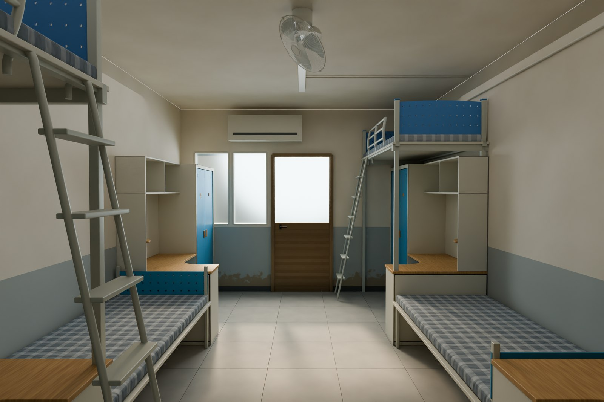
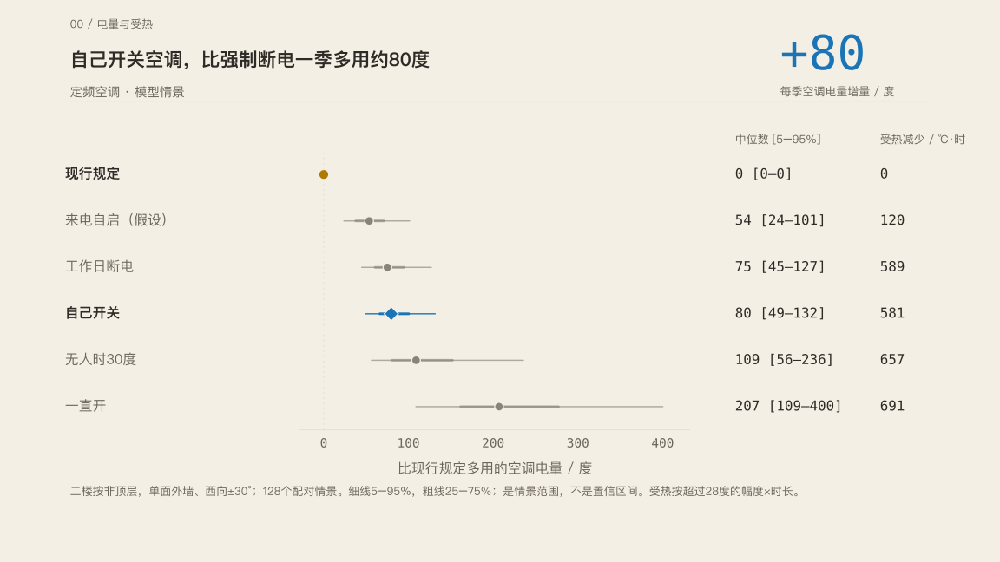
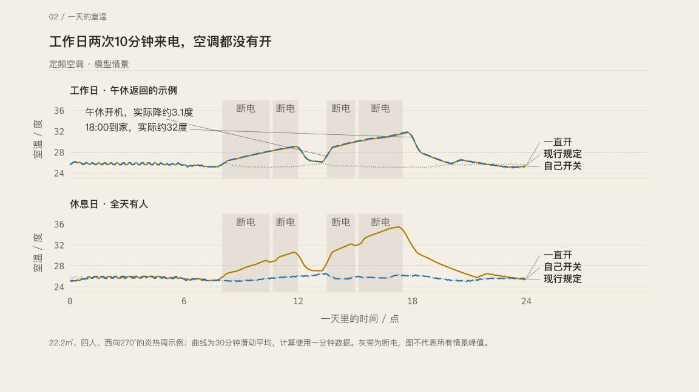
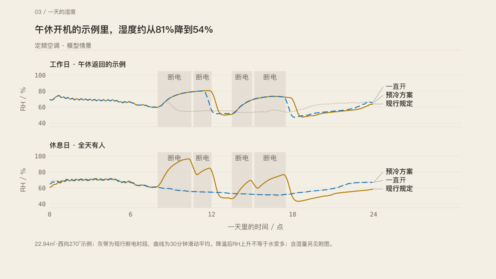
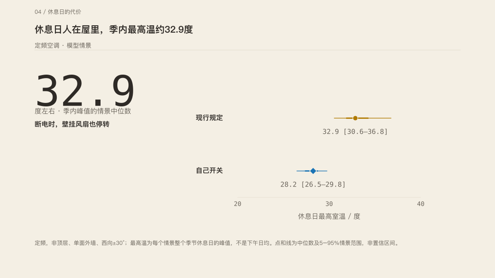
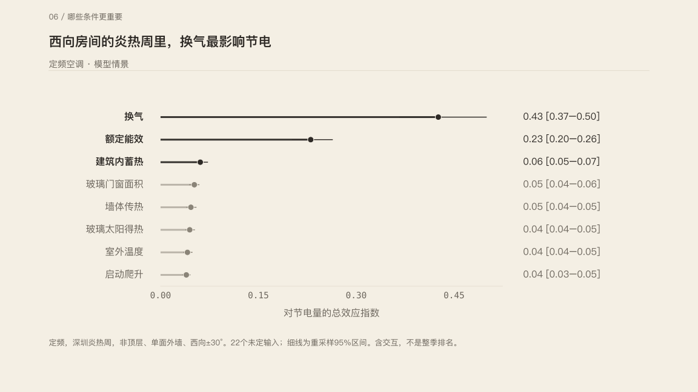
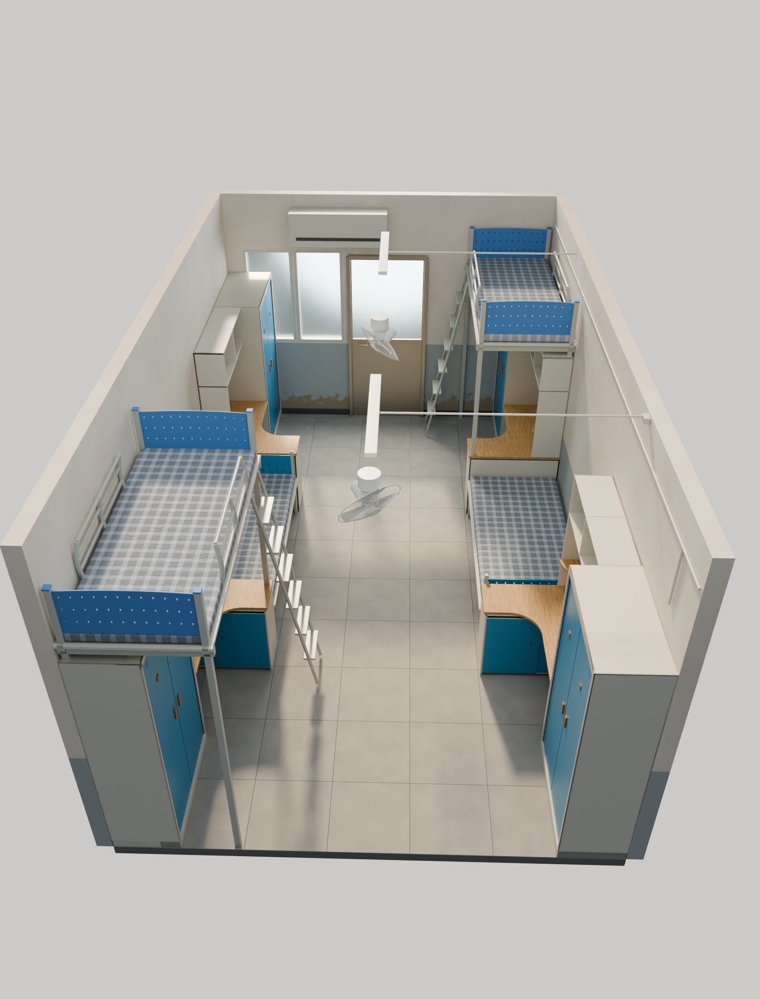
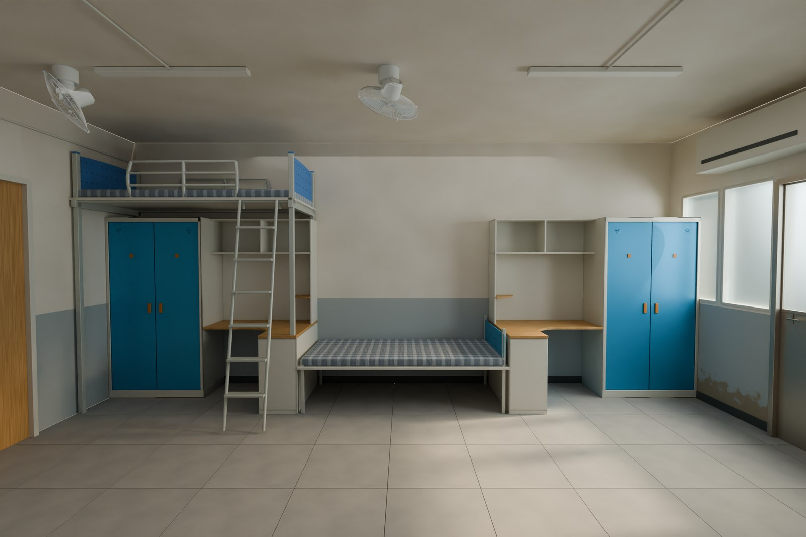

# 宿舍供电时刻、空调电量与温湿度

厂区宿舍有条规定：一到上班时间就断电，周六周日也一样，到了休息时间才能再开。我想让他们取消这条规定。光说热没人听，只好去算：一直开着和到点关掉，到底哪个更费电。

说实话挺无奈的。想吹上空调，得先做一个研究。



<small>示意图，按记忆与照片重建，尺寸为推算；不参与计算。</small>

**工作日里，强制断电和“人走自己关”耗电几乎一样；多用的电主要集中在休息日白天有人时。** 按已确认的西向、单面外墙和二楼非顶层假设估算，定频空调每个休息日多用约1.4度，整季多约71度。换来的是休息日有人时能持续开空调，不必等来电。

工作日差值中位数为0.03度/天，取整约0度；存在跨日蓄热和少量待机差异，因此不是数学上全部恰好为零。工作日与休息日的范围、顶层及转角对照见后面的表。

没有现场电量或温湿度校准，也没有与成熟建筑仿真工具对算。数字是带假设的模型情景，不是宿舍实测；风扇停转的体感未算。

**以下为中位数（5–95%情景范围），不是实测置信区间。** 三种房间、两种空调、七条规则配对计算，人员日历和气象共用。

## 先看图

以下电量与季节峰温图用128组西向±30°样本；二楼按非顶层，单面外墙。日内曲线固定西向270°；敏感性也固定非顶层、单面外墙，只分析西向范围和其余未定输入。受热是有人时超过28度的幅度乘时长，不是健康等级。

<picture>
  <source media="(max-width: 600px) and (prefers-color-scheme: dark)" srcset="figures/00_主结论_暗_窄.svg">
  <source media="(max-width: 600px)" srcset="figures/00_主结论_亮_窄.svg">
  <source media="(prefers-color-scheme: dark)" srcset="figures/00_主结论_暗.svg">
  
</picture>

## 一天里的室温与湿度

工作日短休无人，来电不会自动制冷；午休返回才开机。工作日与休息日上下对齐、共用坐标。这里是定频基准示例；居中的30分钟滑动平均会模糊启停边界，不用它读精确开机时刻或峰值。原始统计仍用一分钟数据。

<picture>
  <source media="(max-width: 600px) and (prefers-color-scheme: dark)" srcset="figures/02_一天室温_暗_窄.svg">
  <source media="(max-width: 600px)" srcset="figures/02_一天室温_亮_窄.svg">
  <source media="(prefers-color-scheme: dark)" srcset="figures/02_一天室温_暗.svg">
  
</picture>

<picture>
  <source media="(max-width: 600px) and (prefers-color-scheme: dark)" srcset="figures/03_一天湿度_暗_窄.svg">
  <source media="(max-width: 600px)" srcset="figures/03_一天湿度_亮_窄.svg">
  <source media="(prefers-color-scheme: dark)" srcset="figures/03_一天湿度_暗.svg">
  
</picture>

## 休息日在屋里要承受什么

<picture>
  <source media="(max-width: 600px) and (prefers-color-scheme: dark)" srcset="figures/04_休息日_暗_窄.svg">
  <source media="(max-width: 600px)" srcset="figures/04_休息日_亮_窄.svg">
  <source media="(prefers-color-scheme: dark)" srcset="figures/04_休息日_暗.svg">
  
</picture>

## 规则之间怎样取舍

<picture>
  <source media="(max-width: 600px) and (prefers-color-scheme: dark)" srcset="figures/05_规则取舍_暗_窄.svg">
  <source media="(max-width: 600px)" srcset="figures/05_规则取舍_亮_窄.svg">
  <source media="(prefers-color-scheme: dark)" srcset="figures/05_规则取舍_暗.svg">
  
</picture>

## 哪些假设最影响结论

<picture>
  <source media="(max-width: 600px) and (prefers-color-scheme: dark)" srcset="figures/06_影响因素_暗_窄.svg">
  <source media="(max-width: 600px)" srcset="figures/06_影响因素_亮_窄.svg">
  <source media="(prefers-color-scheme: dark)" srcset="figures/06_影响因素_暗.svg">
  
</picture>

## 附图与机型对照

整季电量、房间大小、附加面积扫描、空气含水量，以及变频机的关键比较列在这里。完整数字表和方法说明在图后。

<picture>
  <source media="(max-width: 600px) and (prefers-color-scheme: dark)" srcset="figures/01_电量_暗_窄.svg">
  <source media="(max-width: 600px)" srcset="figures/01_电量_亮_窄.svg">
  <source media="(prefers-color-scheme: dark)" srcset="figures/01_电量_暗.svg">
  
</picture>

<picture>
  <source media="(max-width: 600px) and (prefers-color-scheme: dark)" srcset="figures/07_房间对照_暗_窄.svg">
  <source media="(max-width: 600px)" srcset="figures/07_房间对照_亮_窄.svg">
  <source media="(prefers-color-scheme: dark)" srcset="figures/07_房间对照_暗.svg">
  
</picture>

<picture>
  <source media="(max-width: 600px) and (prefers-color-scheme: dark)" srcset="figures/附01_相图_暗_窄.svg">
  <source media="(max-width: 600px)" srcset="figures/附01_相图_亮_窄.svg">
  <source media="(prefers-color-scheme: dark)" srcset="figures/附01_相图_暗.svg">
  
</picture>

<picture>
  <source media="(max-width: 600px) and (prefers-color-scheme: dark)" srcset="figures/附02_含湿量_暗_窄.svg">
  <source media="(max-width: 600px)" srcset="figures/附02_含湿量_亮_窄.svg">
  <source media="(prefers-color-scheme: dark)" srcset="figures/附02_含湿量_暗.svg">
  
</picture>

<picture>
  <source media="(max-width: 600px) and (prefers-color-scheme: dark)" srcset="figures/附03_变频主结论_暗_窄.svg">
  <source media="(max-width: 600px)" srcset="figures/附03_变频主结论_亮_窄.svg">
  <source media="(prefers-color-scheme: dark)" srcset="figures/附03_变频主结论_暗.svg">
  
</picture>

<picture>
  <source media="(max-width: 600px) and (prefers-color-scheme: dark)" srcset="figures/附04_变频规则取舍_暗_窄.svg">
  <source media="(max-width: 600px)" srcset="figures/附04_变频规则取舍_亮_窄.svg">
  <source media="(prefers-color-scheme: dark)" srcset="figures/附04_变频规则取舍_暗.svg">
  
</picture>

## 这间宿舍

房间净尺寸3.70×6.20×2.80米；两端各2.10米桌柜与高架床单元，加中段2.00米落地床，组成6.20米房长。两张高架床、两张落地床、四张L形桌及四只双门柜对应四人的蓄热与在室热源；两扇磨砂窗和阳台门上半对应1.90㎡净玻璃，门下半金属板及框单独作为不透明传热分支。







<small>示意图，按记忆与照片重建，尺寸为推算；不参与计算。</small>

## 数据表、口径与模型边界


取消强制断电，并不等于全天开空调。更实际的对照是保留整间供电，人走自己关空调、人回再开；休息日有人时保持供电。

- 定频：现行规定相对一直开节电 17.2（10.4–23.2）%；改成自主开关，整季相对现行规定多用 71（43–121） kWh。
- 变频：现行规定相对一直开节电 16.3（10.5–21.2）%；改成自主开关，整季相对现行规定多用 56（35–89） kWh。

**工作日两次10分钟供电时无人，空调不会自己开，因此没有空调制冷恢复。** 午休只有回来才开；下班也要到家后手动开。提前恢复电源不等于提前制冷，这一点会改变规则之间的取舍。

## 已确认与仍在假设的条件

- 实际四人间、住4人。家具是两张高架床、两张落地床、四张L形桌、四只双门铁柜。房间工作尺寸约3.7×6.2×2.8米，依据过道横向三块砖加两排家具、家具占满长墙及口述，仍非实测；净宽3.6–4.4、净长6.0–6.4、净高2.6–3.2米作为情景范围。床长约占3.3格，场景判读地砖更可能0.6米，把握中低，仍未实测。0.8米砖的4.3×6.2米及口述上限4.8×6.2米另列对照。
- 每天含休息日均按四段断电：08:00–10:30、10:40–12:00、13:30–15:00、15:10–17:30。其间供电10、90、10分钟；17:30至次日08:00持续供电。断电时包括壁挂风扇在内的全部用电设备停转；这不等于门窗漏风或自然换气为零。
- 来电后空调必须手动重新打开。工作日两次短休无人，不开机；午休返回概率基准0.5、情景0–1，固定随机日历共享。返回日假设12:00后5分钟抵达（范围0–15分钟）；下班后30分钟抵达，即基准18:00（延迟范围0–60分钟）。到家或休息日来电后，再等1分钟手动开机（范围0–5分钟）。返回日按4人同时回来简化，实际可能只有部分人回。
- 阳台外墙有两扇磨砂窗及半玻璃半金属门。两窗净玻璃各0.495×1.085米，门上半净玻璃0.830×0.9975米，净玻璃合计1.902075㎡；1.6–2.4㎡作为照片推算与遮框误差的情景范围，非测量置信区间。门下半不透明金属板按0.945㎡、框按0.4638375㎡单列，均不透射太阳辐射；框不再叠加算成玻璃。金属板及框的传热、太阳吸收是未测假设，范围见方法和参数表。已确认二楼、非转角、阳台朝西，方位270°±30°；两侧长墙邻室，另一端走廊，总层数未知，二楼按非顶层处理。下午两段断电与西晒重合，中间15:00只有10分钟供电。
- 四套家具有效热容暂取0.5 MJ/K、范围0.2–1.0 MJ/K，质量未测，未采用未经测量的精确质量。内墙地顶有效热容按面积密度缩放：约130 kJ/(㎡·K)，情景52–313 kJ/(㎡·K)；物性按面积密度给定；家具热容不再乘四，也不随房间面积重复放大。
- 基准空调制冷量3500 W，情景2600–5000 W，机型与性能均未核；所有房间对照使用相同机组参数。气象为深圳SWERA与广州CSWD典型年，各64个参数样本（默认共128），不是实际厂区天气。广州原始RH有38小时为101%，保留原文件，换算时按100%并保存清单。

## 朝向、顶层和转角分开看

二楼、非转角、阳台朝西已确认；总层数未知，非顶层仍为假设。方位为270°±30°。四种工况共用完全相同的128组其他输入、气象和人员日历，朝东只把方位旋转180°，顶层只增加暴露屋面，转角只增加侧外墙及其派生蓄热。三种对照均不是本宿舍已确认状态。

|建筑工况|空调|样本数|现行相对一直开节电 %|自己开关整季多用 度|工作日日均多用 度|休息日日均多用 度|现行休息日季内最高温 °C|
|---|---|---|---|---|---|---|---|
|二楼西向·单面外墙（基准）|定频|128|17.2（10.4–23.2）|71（43–121）|0.03（-0.07–0.05）|1.35（0.75–2.29）|32.7（30.4–36.5）|
|二楼西向·单面外墙（基准）|变频|128|16.3（10.5–21.2）|56（35–89）|0.02（-0.04–0.04）|1.06（0.63–1.67）|32.9（30.5–36.8）|
|朝东对照·非顶层单面外墙|定频|128|17.3（9.8–23.6）|71（41–123）|0.03（-0.06–0.05）|1.30（0.72–2.28）|31.3（29.2–35.0）|
|朝东对照·非顶层单面外墙|变频|128|16.7（11.0–22.0）|55（35–88）|0.02（-0.04–0.04）|1.05（0.62–1.65）|31.6（29.6–35.1）|
|顶层对照·西向单面外墙|定频|128|25.2（15.9–34.3）|117（72–210）|-0.03（-0.13–0.03）|2.34（1.41–4.08）|37.2（32.5–42.9）|
|顶层对照·西向单面外墙|变频|128|21.6（12.0–32.3）|89（49–162）|-0.02（-0.11–0.02）|1.79（0.92–3.35）|37.2（32.5–42.9）|
|转角对照·非顶层西向|定频|128|22.4（13.7–30.1）|95（58–164）|0.01（-0.09–0.04）|1.84（1.06–3.16）|34.0（31.0–38.3）|
|转角对照·非顶层西向|变频|128|18.6（12.0–26.1）|67（42–122）|0.00（-0.06–0.03）|1.29（0.79–2.35）|34.1（31.1–38.3）|

下面直接比较同一样本的建筑工况差值；正数表示对照工况比西向基准更高，范围不是两列分位数相减。

|相对西向基准|空调|现行整季电量变化 度|自己开关额外用电变化 度|现行休息日峰温变化 °C|
|---|---|---|---|---|
|朝东对照·非顶层单面外墙|定频|-12（-28–10）|-1（-4–1）|-1.3（-2.7–-0.5）|
|朝东对照·非顶层单面外墙|变频|-14（-32–7）|-0（-3–1）|-1.3（-2.7–-0.5）|
|顶层对照·西向单面外墙|定频|230（127–456）|42（20–88）|4.5（1.4–7.0）|
|顶层对照·西向单面外墙|变频|249（128–474）|31（3–92）|4.3（1.5–7.1）|
|转角对照·非顶层西向|定频|87（23–223）|22（10–44）|1.1（0.4–2.2）|
|转角对照·非顶层西向|变频|95（24–222）|10（2–40）|1.1（0.4–2.1）|

未另注明的季节图表都使用西向基准128组。完整数据见 `results/building_confirmed.csv.gz`；本报告只使用定稿房间的当前计算结果。

## 电量：一直开、现行规定、自主开关

制冷季假设五月至十月连续184天，起始星期一；不从典型年拼接年份推断真实星期。单日电量是季内工作日平均，整季含休息日；只计空调，不含风扇等其他电器电量。下表使用二楼按非顶层、单面外墙、西向±30°的128个配对样本（两站各64组），对应主房间的尺寸包络（21.60–28.16㎡），不是只固定22.94㎡的结果；时间曲线和确定算例另用22.94㎡基准。均匀抽样是试算选择，不把“地砖更可能0.6米”强行量化为概率。

|空调|一直开：工作日日均 kWh|现行规定：工作日日均 kWh|一直开：整季 kWh|现行规定：整季 kWh|节电比例 %|
|---|---|---|---|---|---|
|定频|5.2（3.5–8.2）|4.3（3.0–6.8）|1046（708–1625）|857（602–1336）|17.2（10.4–23.2）|
|变频|4.5（3.0–6.8）|3.7（2.5–5.8）|896（613–1347）|742（505–1133）|16.3（10.5–21.2）|

|空调|现行规定整季 kWh|自主开关整季 kWh|自主开关比现行规定多用 kWh|来电自启假设整季 kWh|
|---|---|---|---|---|
|定频|857（602–1336）|945（655–1449）|71（43–121）|911（634–1407）|
|变频|742（505–1133）|801（546–1214）|56（35–89）|775（528–1177）|

差值按同一情景配对计算，中位数分别统计，不一定等于两列中位数相减。来电自启只是功能相反的假想对照，不是本人机组的真实行为；其人员日历不变。


## 两次10分钟、午休90分钟究竟能恢复多少

温差为供电前温度减去窗口结束温度，正数是降温、负数是升温。RH受温度与水量共同影响；含湿量下降才表示空气里的水蒸气减少。每个情景先对季内同类日取平均，再跨情景给范围。

|日型|空调|供电窗口|开始室温 °C|结束室温 °C|降温 °C|开始RH %|结束RH %|含湿量下降 g/kg|
|---|---|---|---|---|---|---|---|---|
|工作日全部|定频|10:30–10:40|27.2（25.8–28.3）|27.3（25.8–28.3）|-0.1（-0.1–-0.0）|76.8（69.9–84.4）|76.5（70.0–84.2）|-0.0（-0.1–0.0）|
|工作日全部|定频|12:00–13:30|27.8（26.2–28.9）|27.3（25.4–28.9）|0.3（-0.5–1.8）|75.9（69.9–83.2）|62.3（49.4–73.2）|3.6（0.5–7.2）|
|工作日全部|定频|15:00–15:10|28.6（26.9–30.3）|28.7（27.0–30.5）|-0.1（-0.2–-0.0）|69.0（59.3–76.4）|69.0（59.8–76.5）|-0.1（-0.3–-0.1）|
|工作日全部|变频|10:30–10:40|27.3（25.8–28.4）|27.4（25.9–28.5）|-0.1（-0.1–-0.0）|76.8（69.6–84.3）|76.4（69.7–84.0）|-0.0（-0.1–0.0）|
|工作日全部|变频|12:00–13:30|27.9（26.2–29.0）|27.5（25.9–29.0）|0.3（-0.6–1.6）|75.7（69.6–82.9）|61.9（50.6–72.9）|3.6（0.6–7.1）|
|工作日全部|变频|15:00–15:10|28.8（27.0–30.5）|28.9（27.1–30.7）|-0.1（-0.2–-0.0）|68.5（59.5–76.0）|68.6（60.2–76.1）|-0.1（-0.3–-0.1）|
|仅午休返回日|定频|12:00–13:30|27.8（26.1–28.8）|26.2（24.7–27.7）|1.4（0.6–2.7）|76.3（70.4–83.5）|53.8（46.7–60.9）|6.5（5.1–8.1）|
|仅午休返回日|变频|12:00–13:30|27.8（26.1–28.9）|26.5（25.2–27.8）|1.1（0.5–2.1）|75.9（69.9–83.4）|54.0（46.2–59.8）|6.5（4.8–7.8）|
|休息日|定频|10:30–10:40|28.2（26.6–29.4）|26.8（25.2–28.0）|1.3（0.8–2.3）|89.5（81.5–96.0）|80.8（71.9–90.0）|3.7（2.2–5.0）|
|休息日|定频|12:00–13:30|28.9（27.2–30.5）|26.4（24.7–27.8）|2.4（1.4–3.9）|85.0（76.4–94.3）|49.9（44.1–57.2）|10.4（8.3–13.5）|
|休息日|定频|15:00–15:10|29.3（27.5–31.4）|27.4（25.8–29.1）|1.9（1.0–3.0）|74.2（65.9–82.0）|68.7（62.9–76.7）|3.3（1.7–4.5）|
|休息日|变频|10:30–10:40|28.3（26.8–29.6）|27.4（26.1–28.7）|0.7（0.4–1.3）|89.2（80.7–95.9）|86.1（77.8–93.7）|1.7（0.8–2.9）|
|休息日|变频|12:00–13:30|29.0（27.3–30.6）|26.6（25.2–27.9）|2.2（1.4–3.7）|86.7（76.4–96.4）|49.6（43.6–56.7）|11.0（8.5–14.8）|
|休息日|变频|15:00–15:10|29.5（27.8–31.5）|28.2（26.6–29.9）|1.3（0.7–2.2）|73.7（65.0–81.5）|71.9（65.1–79.5）|1.7（0.9–3.1）|

工作日全部平均包含无人返回、不启动空调的午休；返回日另列，避免把两者混淆。极低返回概率情景若没有返回日，其条件统计不适用，但仍保留在全季电量和全部工作日统计中。两次10分钟的工作日温湿变化来自自然热湿交换与残余回蒸，不是空调制冷。

|空调|窗口|现行规定结束室温 °C|假设自启结束室温 °C|现行规定结束RH %|假设自启结束RH %|
|---|---|---|---|---|---|
|定频|10:30–10:40|27.3（25.8–28.3）|26.3（24.9–27.6）|76.5（70.0–84.2）|70.5（64.3–77.5）|
|定频|15:00–15:10|28.7（27.0–30.5）|26.4（24.9–27.7）|69.0（59.8–76.5）|62.8（53.1–68.8）|
|变频|10:30–10:40|27.4（25.9–28.5）|26.7（25.4–27.9）|76.4（69.7–84.0）|73.6（68.5–80.8）|
|变频|15:00–15:10|28.9（27.1–30.7）|27.1（25.7–28.3）|68.6（60.2–76.1）|64.8（55.1–71.7）|

10分钟不足以证明连续30分钟舒适；午休13:30后仍会再次断电。逐日窗口前后状态、在室标志、冷凝、排水、回蒸和电量在 `results/west_window_daily.csv.gz`。


## 下班到家后，多久凉下来、多久温湿同时合适

从实际到家时刻计时，已包含到家后开机反应；不把无人时从17:30送电到回家的延迟说成人在室内等待。温度条件为不高于28°C并持续30分钟；联合条件再要求RH≤65%。均为计算阈值，未含风速、辐射温度、空气质量及个人感受。

|空调|17:30送电时室温 °C|到家时室温 °C|到家RH %|到家热指数 °C|30分钟仍未温度达标 %|90分钟仍未温度达标 %|90分钟仍未联合达标 %|六小时仍未联合达标 %|
|---|---|---|---|---|---|---|---|---|
|定频|29.2（27.5–31.1）|29.3（27.5–31.2）|70.4（62.4–77.6）|33.7（30.6–36.8）|48.1（0.0–95.9）|17.0（0.0–93.7）|25.8（2.5–96.2）|6.8（0.0–94.2）|
|变频|29.3（27.6–31.3）|29.4（27.7–31.4）|69.7（62.3–77.0）|34.0（31.0–37.0）|6.4（0.0–70.4）|0.0（0.0–38.7）|5.3（0.0–44.9）|2.7（0.0–13.4）|

不把六小时封顶中位数当成保证恢复时刻。连续30分钟的要求较严格，温控启停略微反复越线也会使其不达标，不表示整个观察期都处在高温高湿。原始逐日恢复事件和截尾标志在 `results/west_recovery_daily.csv.gz`；数据仍保存温度与联合恢复两列，主要阅读上表未达标比例。一直开也可能有高湿或容量不足，不能把现行规定的全部等待都归因于断电。


## 休息日有人，却仍然断电

|空调|断电时段平均室温 °C|同一时段平均RH %|季内休息日最高室温 °C|休息日>28°C小时数|休息日RH>65%小时数|休息日日均节电 kWh|
|---|---|---|---|---|---|---|
|定频|28.7（27.0–30.1）|76.1（69.9–82.3）|32.7（30.4–36.5）|321（63–926）|700（433–861）|1.3（0.7–2.3）|
|变频|28.8（27.2–30.4）|77.4（70.2–83.5）|32.9（30.5–36.8）|335（90–594）|632（372–814）|1.0（0.6–1.6）|

最高温是季内休息日的最高值，不是日均。断电时壁挂风扇和其他通风设备也停止，因此实际体验还少了吹风；模型没有计算风速体感，不能据此精确评估床位舒适。漏风和自然换气仍保留假设，不写成零通风。


## 替代规则的取舍

“提前供电·仍需手动”合并到“仅工作日断电”展示：工作日11:00、16:30提前来电时仍无人，不会预冷；两条规则都在休息日持续供电。两者的制冷可用时段相同，微小电量差来自额外通电期间的待机与其他电器热源；完整原始七规则仍保留在数据表。无人时30°C属于设备支持温控管理的条件对照，尚未核实本机有此功能。

|空调|规则|整季电量 kWh|相对一直开节电 %|新增有人热暴露 °C·h|有人RH>65%小时数|
|---|---|---|---|---|---|
|定频|一直开|1046（708–1625）|0.0（0.0–0.0）|0（0–0）|1970（801–2477）|
|定频|现行规定·手动开机|857（602–1336）|17.2（10.4–23.2）|445（40–1270）|1668（769–2184）|
|定频|仅工作日断电|940（651–1443）|10.9（5.4–15.4）|40（2–270）|1560（612–2217）|
|定频|无人时调至30°C|964（661–1511）|8.3（4.1–12.1）|13（0–90）|1585（615–2211）|
|定频|自主开关·全程供电|945（655–1449）|10.4（4.8–15.0）|43（3–281）|1550（606–2203）|
|定频|来电自启·假设对照|911（634–1407）|12.2（7.7–17.8）|361（29–997）|1747（875–2310）|
|变频|一直开|896（613–1347）|0.0（0.0–0.0）|0（0–0）|1663（337–2430）|
|变频|现行规定·手动开机|742（505–1133）|16.3（10.5–21.2）|476（68–1381）|1438（547–2093）|
|变频|仅工作日断电|795（542–1208）|10.4（5.9–14.3）|36（3–259）|1311（238–2069）|
|变频|无人时调至30°C|824（558–1216）|8.4（5.1–11.6）|11（0–60）|1316（230–2072）|
|变频|自主开关·全程供电|801（546–1214）|9.8（5.2–13.9）|37（4–270）|1301（234–2055）|
|变频|来电自启·假设对照|775（528–1177）|12.8（9.4–16.4）|403（51–1129）|1469（530–2205）|

热暴露为有人时超过28°C的幅度乘时长，不含风速和过冷代价。高温与高湿小时可能重叠，不能相加。RH小时也不能单独排名：更热的空气本身会压低RH读数，即使水分没有减少，较少RH超标小时也不表示更舒适。


## 尺寸对照

三个房间均为四人、同一套家具数量和同一台空调参数。主房间按尺寸范围抽样，0.8米砖与口述上限对照固定长宽，层高、门窗和机组等共用配对参数。不是三间实测宿舍，也不是面积纯因果效应。

|房间|空调|现行规定整季电量 kWh|相对一直开节电 %|休息日最高室温 °C|六小时未联合达标 %|
|---|---|---|---|---|---|
|约22.94㎡（3.7×6.2米）|定频|857（602–1336）|17.2（10.4–23.2）|32.7（30.4–36.5）|6.8（0.0–94.2）|
|约22.94㎡（3.7×6.2米）|变频|742（505–1133）|16.3（10.5–21.2）|32.9（30.5–36.8）|2.7（0.0–13.4）|
|0.8米砖对照26.66㎡（4.3×6.2米）|定频|864（609–1350）|17.5（10.5–23.9）|32.5（30.2–36.2）|6.8（0.0–93.2）|
|0.8米砖对照26.66㎡（4.3×6.2米）|变频|756（513–1171）|16.1（10.1–21.2）|32.6（30.3–36.4）|2.7（0.0–14.4）|
|口述上限29.76㎡（4.8×6.2米）|定频|884（614–1400）|18.0（10.7–24.5）|32.3（30.0–36.0）|7.6（0.0–92.1）|
|口述上限29.76㎡（4.8×6.2米）|变频|790（525–1235）|16.1（9.9–21.4）|32.4（29.9–36.1）|3.8（0.0–15.6）|

精确工作尺寸的基准结果见 `results/west_room_comparison.csv`。墙窗传热、屋面、室内蓄热与空调单位面积能力都会一起改变，不只改变空气体积。


## 启停与折算效率

折算效率为整季实际输出冷量/空调总电量，含风机和待机，不是能效标签；未把两类机组的差距拟合到预设比例。

|空调|一直开：每天启动|现行规定：每天启动|一直开：折算效率|现行规定：折算效率|
|---|---|---|---|---|
|定频|77.0（51.6–110.8）|53.4（39.8–75.7）|3.82（2.81–4.84）|3.99（2.90–5.06）|
|变频|2.7（0.2–37.7）|3.2（2.1–20.6）|4.50（3.40–5.50）|4.63（3.49–5.71）|

## 启停次数为什么不能当实机预测

最短开机时间180–600秒、最短停机时间120–300秒分别做3档，两站共54条定频整季轨迹；其余参数固定为22.94㎡、非顶层、单面外墙、朝西270°的默认值。它是额外确定参数扫描，没有并入主情景区间。下表停机时间固定180秒；完整9组合见 `results/west_cycle_timer_scan.csv`。

|气象|最短开机 分钟|一直开每天启动|现行每天启动|一直开开机段10–90% 分钟|现行相对一直开节电 %|自己开关多用 度/季|
|---|---|---|---|---|---|---|
|shenzhen|3|140.1|83.2|3.0–3.0|18.1|78|
|shenzhen|5|85.2|53.2|5.0–5.0|17.0|72|
|shenzhen|10|43.6|29.2|10.0–10.0|15.9|66|
|guangzhou|3|128.7|79.2|3.0–3.0|17.3|72|
|guangzhou|5|78.9|50.6|5.0–5.0|16.2|67|
|guangzhou|10|40.6|27.7|10.0–10.0|15.1|61|

开机段按一分钟输出连续运行段统计，剔除边界截断段，保留强制断电中断。基准很多开机段贴着最短时间，时间加倍会显著减少启动次数；节电率的变化需看同站同组合，不能把每天启动数当作现场预测。该扫描已按西向270°更新；以表中的同站5分钟和10分钟两行判断启动数与节电率如何变化。

## 哪些条件更影响结果

仅针对深圳站一个炎热周、主房间及固定时刻，以512对基础样本和26个输入做全局敏感性分析；不代表整季名次。该扫描固定非顶层、单面外墙，方位限制为西向±30°，不再把顶层/转角当未知开关。指数大小仍依赖26个未定输入的所选范围。输入含返回和手动反应延迟，已知人数不再抽样。总效应包含交互，不加总成百分比，区间是配对重采样95%范围。

- 定频节电量：换气 0.47（0.40–0.54）、额定能效 0.22（0.19–0.25）、墙体传热 0.07（0.06–0.08）。
- 定频热暴露：建筑内蓄热 0.51（0.42–0.60）、设定温度 0.22（0.19–0.27）、制冷能力 0.13（0.10–0.16）。
- 变频节电量：换气 0.57（0.49–0.65）、额定能效 0.20（0.17–0.23）、室内热耦合 0.07（0.06–0.08）。
- 变频热暴露：建筑内蓄热 0.50（0.41–0.59）、设定温度 0.20（0.17–0.23）、制冷能力 0.14（0.11–0.18）。

区间重叠时不强调精确排名。主相图固定四人、相同门窗与机组，按固定断电与手动行为扫描面积及墙体传热；不以单段时长替代规定。


## 方法、核对与局限

- 空气、内墙家具蓄热体、外墙屋顶合并节点，共三个热节点；另有空气含湿量和盘管存水状态。一分钟积分，逐时气象驱动，人员与设备热源随在室和供电变化。
- 定频最短开机基准300秒、核对范围180–600秒，最短停机180秒、核对范围120–300秒；另做两站整季3×3时间组合扫描。这两项未加入原全局抽样，启动次数是计时器与控制假设的产物，不能当作实机预测；启动爬升基准45秒、范围15–90秒。变频有部分负荷效率和容量约束；两类曲线是假设，未有厂家校准。电量按实际可用容量和效率计算，未把空气侧上限再算成额外损耗。
- 除湿按进风温湿度、有效盘管露点、风量与旁通比例动态分配显潜热，记录盘管存水、排水和停机回蒸；另扫盘管温度/风量/存水量。盘管露点在每条轨迹内固定（基准12°C），不随变频转速改变，可能高估低速除湿。仍没有独立湿控、材料吸湿、湿盘管完整厂家曲线或床位空间差异，不能保证主观不闷。
- 内置热水余额只是离散自检。`audit.py`在一个炎热周内、无预热且初态已知时，另从输入气象与保存状态做热、水后处理记账；冷量与运行比例仍读自模拟输出，电量是按同一功率公式重算。篡改输出的测试能检出部分差错，但没有独立求解控制与盘管，也不是整季或实测验证。证据见 `results/west_independent_budgets.csv`。
- 一节点指数解、三节点矩阵指数解、湿量混合解析解及步长/预热/收尾/气象替换检查均有记录。五分钟显式步长在紧凑主房间不稳定，已拒绝，不列作物理结果；主结果用一分钟。**没有运行EnergyPlus对算，没有现场温湿度与电量验证。** 两周电费较低的回忆最多说方向一致。
- 外墙有效蓄热只相当于约36毫米混凝土，并非实际墙厚；屋面与墙共用U值和一个节点，可能夸大顶层高温，尤其高温尾部，不能把高温尾部当现场预测。无阳台挑檐遮阳，人体显热/潜热各为常数、不随室温调整。相邻房间热交换、门窗实际开合、天空长波、风扇体感未模拟；风机热未单独反馈室内。门窗默认关闭，换气是假设。若阳台门经常开着，需另算换气工况。
- 参数范围、来源、固定与派生方式见 `data/confirmed_parameters.csv`；详见 [模型与来源](模型与来源.md)。家具材料质量尚未核实，不能拿场景概念图当作精确热模型或气流仿真。

## 复现与待核实资料

逐分钟曲线以无损压缩的 `.csv.gz` 保存，读取后的数值不变。公开包保留定稿房间的完整汇总结果与西向逐分钟轨迹；广朝向的逐分钟轨迹可选生成，不随包提供。如需生成广朝向轨迹，运行 `uv run --frozen python run.py --traces-only`。

在本目录运行，需Python 3.12与uv，按锁文件安装依赖；原始气象和哈希已保存。

```sh
uv run --frozen python -m pytest -q
uv run --frozen python run_confirmed.py
uv run --frozen python verify_confirmed.py
uv run --frozen python render_figures.py --report
```

场景重建需要Blender 4.2 LTS，已用4.2.23验证。运行 `blender --background --factory-startup --python scene/source/build_model.py` 可生成场景；五个视角的渲染和JPG压缩命令见 [场景说明](scene/README.md)。场景图不参与热计算。

只更新图表、不运行仿真时，可运行 `uv run --frozen python render_figures.py --report`。图表需系统苹方SC、Noto Sans SC或思源黑体之一；图件使用苹方SC，导出的SVG已转曲，阅读图件不依赖字体安装。

默认128个共用参数样本。西向主基准三种房间×两类机组×七条规则，共5376条整季轨迹；朝东/顶层/转角各在主房间计算一直开、现行和自己开关，共2304条对照，总计7680条。Sobol基础样本512对、26个输入。随机种子固定，执行测试、数据、八张核心图及四张补充图和本文生成；每张有亮暗、宽窄四版PNG与SVG。

二楼、非转角、阳台朝西已经确认；总层数未知，非顶层仍是明确假设。方位精度、净尺寸与层高、玻璃面积、门窗开合、机组曲线和返回延迟仍非实测，是结果的未解决局限；将来有实测温湿度和分项电量后才能进一步校准。

## 许可

代码以 [MIT 许可](LICENSE) 发布。文字与图以 [CC BY 4.0](https://creativecommons.org/licenses/by/4.0/deed.zh-hans) 发布，转载请注明出处。气象数据沿用其原始来源的许可。
