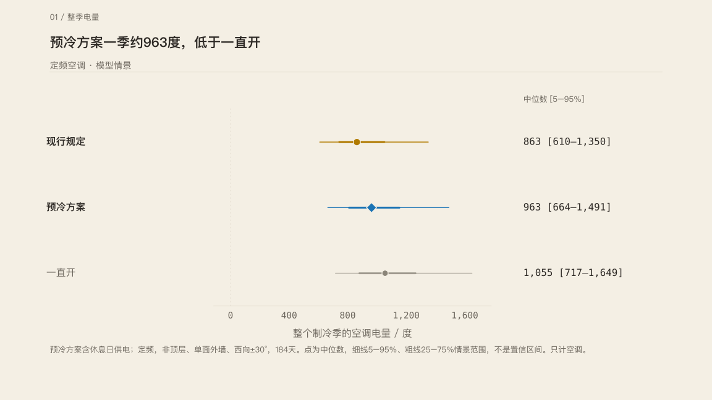
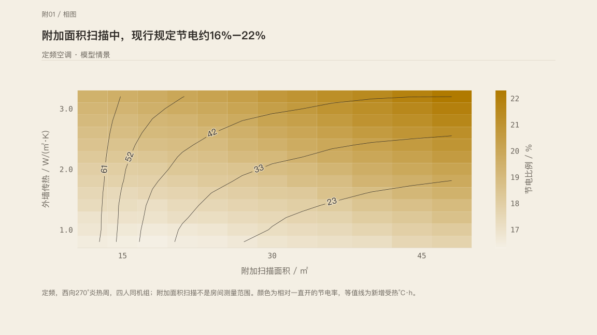
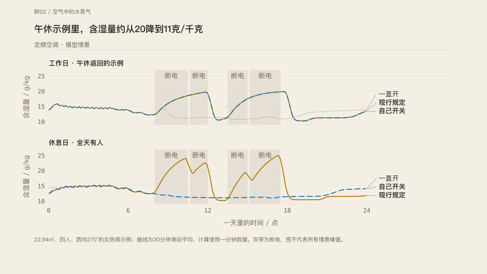
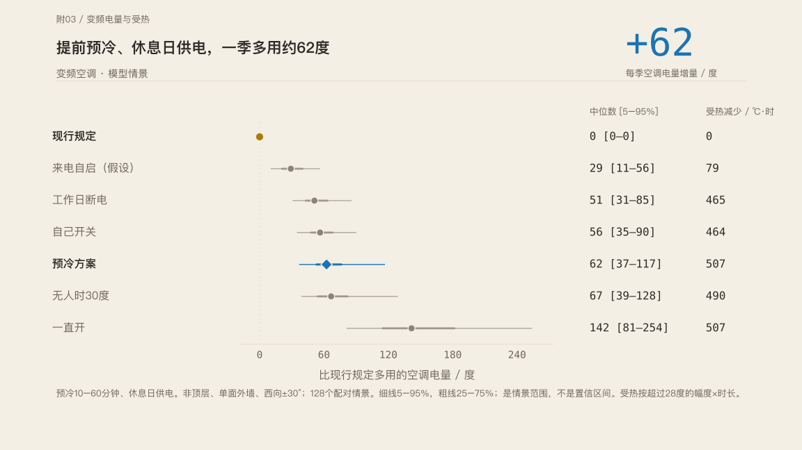
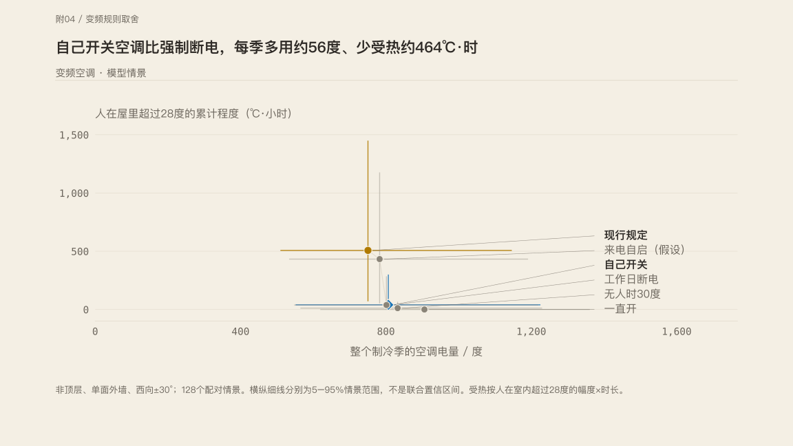

# 宿舍供电时刻、空调电量与温湿度

厂区宿舍有条规定：一到上班时间就断电，周六周日也一样，到了休息时间才能再开。我想让他们取消这条规定。光说热没人听，只好去算：一直开着和到点关掉，到底哪个更费电。

说实话挺无奈的。想吹上空调，得先做一个研究。

**工作日里，强制断电和“人走自己关”耗电几乎一样；多用的电主要集中在休息日白天有人时。** 按已确认的西向、单面外墙和二楼非顶层假设估算，定频空调每个休息日多用约1.5度，整季多约80度。换来的是休息日有人时能持续开空调，不必等来电。

工作日差值中位数为0.02度/天，取整约0度；存在跨日蓄热和少量待机差异，因此不是数学上全部恰好为零。工作日与休息日的范围、顶层及转角对照见后面的表。

没有现场电量或温湿度校准，也没有与成熟建筑仿真工具对算。数字是带假设的模型情景，不是宿舍实测；风扇停转的体感未算。

**以下为中位数（5–95%情景范围），不是实测置信区间。** 三种房间、两种空调、七条规则配对计算，人员日历和气象共用。

## 先看图

以下电量与季节峰温图用128组西向±30°样本；二楼按非顶层，单面外墙。日内曲线固定西向270°；敏感性也固定非顶层、单面外墙，只分析西向范围和其余未定输入。受热是有人时超过28度的幅度乘时长，不是健康等级。

<picture>
  <source media="(max-width: 600px) and (prefers-color-scheme: dark)" srcset="figures/00_主结论_暗_窄.svg">
  <source media="(max-width: 600px)" srcset="figures/00_主结论_亮_窄.svg">
  <source media="(prefers-color-scheme: dark)" srcset="figures/00_主结论_暗.svg">
  
</picture>

## 一天里的室温与湿度

工作日短休无人，来电不会自动制冷；午休返回才开机。工作日与休息日上下对齐、共用坐标。这里是定频基准示例；居中的30分钟滑动平均会模糊启停边界，不用它读精确开机时刻或峰值。原始统计仍用一分钟数据。

<picture>
  <source media="(max-width: 600px) and (prefers-color-scheme: dark)" srcset="figures/02_一天室温_暗_窄.svg">
  <source media="(max-width: 600px)" srcset="figures/02_一天室温_亮_窄.svg">
  <source media="(prefers-color-scheme: dark)" srcset="figures/02_一天室温_暗.svg">
  
</picture>

<picture>
  <source media="(max-width: 600px) and (prefers-color-scheme: dark)" srcset="figures/03_一天湿度_暗_窄.svg">
  <source media="(max-width: 600px)" srcset="figures/03_一天湿度_亮_窄.svg">
  <source media="(prefers-color-scheme: dark)" srcset="figures/03_一天湿度_暗.svg">
  
</picture>

## 休息日在屋里要承受什么

<picture>
  <source media="(max-width: 600px) and (prefers-color-scheme: dark)" srcset="figures/04_休息日_暗_窄.svg">
  <source media="(max-width: 600px)" srcset="figures/04_休息日_亮_窄.svg">
  <source media="(prefers-color-scheme: dark)" srcset="figures/04_休息日_暗.svg">
  
</picture>

## 规则之间怎样取舍

<picture>
  <source media="(max-width: 600px) and (prefers-color-scheme: dark)" srcset="figures/05_规则取舍_暗_窄.svg">
  <source media="(max-width: 600px)" srcset="figures/05_规则取舍_亮_窄.svg">
  <source media="(prefers-color-scheme: dark)" srcset="figures/05_规则取舍_暗.svg">
  
</picture>

## 哪些假设最影响结论

<picture>
  <source media="(max-width: 600px) and (prefers-color-scheme: dark)" srcset="figures/06_影响因素_暗_窄.svg">
  <source media="(max-width: 600px)" srcset="figures/06_影响因素_亮_窄.svg">
  <source media="(prefers-color-scheme: dark)" srcset="figures/06_影响因素_暗.svg">
  
</picture>

## 附图与机型对照

整季电量、房间大小、附加面积扫描、空气含水量，以及变频机的关键比较列在这里。完整数字表和方法说明在图后。

<picture>
  <source media="(max-width: 600px) and (prefers-color-scheme: dark)" srcset="figures/01_电量_暗_窄.svg">
  <source media="(max-width: 600px)" srcset="figures/01_电量_亮_窄.svg">
  <source media="(prefers-color-scheme: dark)" srcset="figures/01_电量_暗.svg">
  
</picture>

<picture>
  <source media="(max-width: 600px) and (prefers-color-scheme: dark)" srcset="figures/07_房间对照_暗_窄.svg">
  <source media="(max-width: 600px)" srcset="figures/07_房间对照_亮_窄.svg">
  <source media="(prefers-color-scheme: dark)" srcset="figures/07_房间对照_暗.svg">
  
</picture>

<picture>
  <source media="(max-width: 600px) and (prefers-color-scheme: dark)" srcset="figures/附01_相图_暗_窄.svg">
  <source media="(max-width: 600px)" srcset="figures/附01_相图_亮_窄.svg">
  <source media="(prefers-color-scheme: dark)" srcset="figures/附01_相图_暗.svg">
  
</picture>

<picture>
  <source media="(max-width: 600px) and (prefers-color-scheme: dark)" srcset="figures/附02_含湿量_暗_窄.svg">
  <source media="(max-width: 600px)" srcset="figures/附02_含湿量_亮_窄.svg">
  <source media="(prefers-color-scheme: dark)" srcset="figures/附02_含湿量_暗.svg">
  
</picture>

<picture>
  <source media="(max-width: 600px) and (prefers-color-scheme: dark)" srcset="figures/附03_变频主结论_暗_窄.svg">
  <source media="(max-width: 600px)" srcset="figures/附03_变频主结论_亮_窄.svg">
  <source media="(prefers-color-scheme: dark)" srcset="figures/附03_变频主结论_暗.svg">
  
</picture>

<picture>
  <source media="(max-width: 600px) and (prefers-color-scheme: dark)" srcset="figures/附04_变频规则取舍_暗_窄.svg">
  <source media="(max-width: 600px)" srcset="figures/附04_变频规则取舍_亮_窄.svg">
  <source media="(prefers-color-scheme: dark)" srcset="figures/附04_变频规则取舍_暗.svg">
  
</picture>

## 数据表、口径与模型边界


取消强制断电，并不等于全天开空调。更实际的对照是保留整间供电，人走自己关空调、人回再开；休息日有人时保持供电。

- 定频：现行规定相对一直开节电 18.5（11.7–25.8）%；改成自主开关，整季相对现行规定多用 80（49–132） kWh。
- 变频：现行规定相对一直开节电 16.4（10.4–22.2）%；改成自主开关，整季相对现行规定多用 59（36–101） kWh。

**工作日两次10分钟供电时无人，空调不会自己开，因此没有空调制冷恢复。** 午休只有回来才开；下班也要到家后手动开。提前恢复电源不等于提前制冷，这一点会改变规则之间的取舍。

## 已确认与仍在假设的条件

- 实际四人间、住4人。家具是两张高架床、两张落地床、四张L形桌、四只双门铁柜。房间工作尺寸约3.7×6.0×2.8米，依据过道横向三块砖加两排家具、家具占满长墙及口述，仍非实测；净宽3.6–4.4、净长5.8–6.4、净高2.6–3.2米作为情景范围。床长约占3.3格，场景判读地砖更可能0.6米，把握中低，仍未实测。0.8米砖的4.3×6米及口述上限4.8×6米另列对照。
- 每天含休息日均按四段断电：08:00–10:30、10:40–12:00、13:30–15:00、15:10–17:30。其间供电10、90、10分钟；17:30至次日08:00持续供电。断电时包括壁挂风扇在内的全部用电设备停转；这不等于门窗漏风或自然换气为零。
- 来电后空调必须手动重新打开。工作日两次短休无人，不开机；午休返回概率基准0.5、情景0–1，固定随机日历共享。返回日假设12:00后5分钟抵达（范围0–15分钟）；下班后30分钟抵达，即基准18:00（延迟范围0–60分钟）。到家或休息日来电后，再等1分钟手动开机（范围0–5分钟）。返回日按4人同时回来简化，实际可能只有部分人回。
- 远端阳台玻璃门及左侧两扇磨砂窗，合计等效开口面积先取3.8㎡、范围2.6–5.2㎡，是尺寸未知时的假设。已确认住二楼、不是转角，只有阳台门窗这面外墙；两侧长墙邻室，另一端为走廊。阳台朝西已由傍晚直晒和室内影子变化确认，基准270°、方位精度范围240–300°。楼总层数未知，二楼先按非顶层处理；朝东、顶层与转角另作配对对照。下午两段断电与西晒时段重合，中间15:00只供电10分钟。
- 四套家具有效热容暂取0.5 MJ/K、范围0.2–1.0 MJ/K，质量未测，未采用未经测量的精确质量。内墙地顶有效热容按面积密度缩放：约130 kJ/(㎡·K)，情景52–313 kJ/(㎡·K)；物性按面积密度给定；家具热容不再乘四，也不随房间面积重复放大。
- 基准空调制冷量3500 W，情景2600–5000 W，机型与性能均未核；所有房间对照使用相同机组参数。气象为深圳SWERA与广州CSWD典型年，各64个参数样本（默认共128），不是实际厂区天气。广州原始RH有38小时为101%，保留原文件，换算时按100%并保存清单。

## 朝向、顶层和转角分开看

二楼、非转角、阳台朝西已确认；总层数未知，非顶层仍为假设。方位为270°±30°。四种工况共用完全相同的128组其他输入、气象和人员日历，朝东只把方位旋转180°，顶层只增加暴露屋面，转角只增加侧外墙及其派生蓄热。三种对照均不是本宿舍已确认状态。

|建筑工况|空调|样本数|现行相对一直开节电 %|自己开关整季多用 度|工作日日均多用 度|休息日日均多用 度|现行休息日季内最高温 °C|
|---|---|---|---|---|---|---|---|
|二楼西向·单面外墙（基准）|定频|128|18.5（11.7–25.8）|80（49–132）|0.02（-0.09–0.05）|1.49（0.88–2.61）|34.5（31.5–39.3）|
|二楼西向·单面外墙（基准）|变频|128|16.4（10.4–22.2）|59（36–101）|0.01（-0.05–0.04）|1.11（0.64–1.95）|34.6（31.6–39.4）|
|朝东对照·非顶层单面外墙|定频|128|18.6（11.1–26.0）|78（48–132）|0.03（-0.09–0.05）|1.46（0.86–2.57）|32.3（30.0–36.3）|
|朝东对照·非顶层单面外墙|变频|128|16.9（10.3–23.2）|58（35–100）|0.01（-0.05–0.04）|1.10（0.63–1.94）|32.5（30.2–36.4）|
|顶层对照·西向单面外墙|定频|128|25.8（17.4–35.2）|124（78–218）|-0.03（-0.14–0.03）|2.51（1.53–4.22）|38.6（33.3–44.4）|
|顶层对照·西向单面外墙|变频|128|22.4（12.5–34.6）|98（54–183）|-0.03（-0.13–0.02）|2.00（1.00–3.63）|38.7（33.5–44.5）|
|转角对照·非顶层西向|定频|128|23.5（15.4–31.1）|104（65–176）|-0.00（-0.10–0.04）|2.01（1.21–3.39）|35.5（32.2–40.1）|
|转角对照·非顶层西向|变频|128|19.5（11.9–27.8）|71（45–130）|-0.01（-0.08–0.03）|1.40（0.83–2.73）|35.6（32.3–40.1）|

下面直接比较同一样本的建筑工况差值；正数表示对照工况比西向基准更高，范围不是两列分位数相减。

|相对西向基准|空调|现行整季电量变化 度|自己开关额外用电变化 度|现行休息日峰温变化 °C|
|---|---|---|---|---|
|朝东对照·非顶层单面外墙|定频|-18（-43–11）|-2（-4–1）|-1.9（-4.1–-0.7）|
|朝东对照·非顶层单面外墙|变频|-20（-46–10）|-1（-4–2）|-1.8（-4.0–-0.6）|
|顶层对照·西向单面外墙|定频|206（110–418）|41（19–86）|4.1（1.3–6.6）|
|顶层对照·西向单面外墙|变频|219（116–455）|36（5–93）|4.0（1.3–6.5）|
|转角对照·非顶层西向|定频|75（12–200）|22（9–42）|0.9（0.1–2.0）|
|转角对照·非顶层西向|变频|83（19–212）|12（3–43）|0.8（0.1–2.0）|

未另注明的季节图表都使用西向基准128组。完整数据见 `results/building_confirmed.csv.gz`；此前广朝向/建筑混合结果仍存为补充原始数据，不作为本宿舍头条。

## 电量：一直开、现行规定、自主开关

制冷季假设五月至十月连续184天，起始星期一；不从典型年拼接年份推断真实星期。单日电量是季内工作日平均，整季含休息日；只计空调，不含风扇等其他电器电量。下表使用二楼按非顶层、单面外墙、西向±30°的128个配对样本（两站各64组），对应主房间的尺寸包络（20.88–28.16㎡），不是只固定22.2㎡的结果；时间曲线和确定算例另用22.2㎡基准。均匀抽样是试算选择，不把“地砖更可能0.6米”强行量化为概率。

|空调|一直开：工作日日均 kWh|现行规定：工作日日均 kWh|一直开：整季 kWh|现行规定：整季 kWh|节电比例 %|
|---|---|---|---|---|---|
|定频|5.8（4.0–9.1）|4.7（3.3–7.3）|1165（795–1796）|934（654–1426）|18.5（11.7–25.8）|
|变频|4.9（3.4–7.5）|4.2（2.8–6.2）|965（685–1460）|823（559–1208）|16.4（10.4–22.2）|

|空调|现行规定整季 kWh|自主开关整季 kWh|自主开关比现行规定多用 kWh|来电自启假设整季 kWh|
|---|---|---|---|---|
|定频|934（654–1426）|1020（706–1555）|80（49–132）|988（691–1510）|
|变频|823（559–1208）|877（599–1301）|59（36–101）|850（584–1268）|

差值按同一情景配对计算，中位数分别统计，不一定等于两列中位数相减。来电自启只是功能相反的假想对照，不是本人机组的真实行为；其人员日历不变。


## 两次10分钟、午休90分钟究竟能恢复多少

温差为供电前温度减去窗口结束温度，正数是降温、负数是升温。RH受温度与水量共同影响；含湿量下降才表示空气里的水蒸气减少。每个情景先对季内同类日取平均，再跨情景给范围。

|日型|空调|供电窗口|开始室温 °C|结束室温 °C|降温 °C|开始RH %|结束RH %|含湿量下降 g/kg|
|---|---|---|---|---|---|---|---|---|
|工作日全部|定频|10:30–10:40|27.5（26.0–28.6）|27.6（26.0–28.7）|-0.1（-0.2–-0.1）|75.2（68.3–83.5）|75.0（68.3–83.2）|-0.0（-0.1–0.0）|
|工作日全部|定频|12:00–13:30|28.3（26.4–29.7）|27.7（25.5–29.7）|0.4（-0.8–2.1）|73.8（67.7–81.7）|60.7（47.1–71.4）|3.8（0.6–7.6）|
|工作日全部|定频|15:00–15:10|29.5（27.5–31.5）|29.5（27.6–31.7）|-0.1（-0.2–-0.0）|65.7（54.8–73.8）|65.9（55.2–74.0）|-0.1（-0.3–-0.1）|
|工作日全部|变频|10:30–10:40|27.7（26.1–28.9）|27.8（26.1–29.0）|-0.1（-0.1–-0.1）|75.1（68.1–83.0）|74.7（68.0–82.8）|-0.0（-0.1–0.0）|
|工作日全部|变频|12:00–13:30|28.3（26.6–29.8）|27.9（26.0–29.8）|0.3（-0.7–2.1）|73.6（66.8–81.1）|59.9（46.8–71.1）|3.8（0.6–7.6）|
|工作日全部|变频|15:00–15:10|29.5（27.6–31.6）|29.6（27.8–31.9）|-0.1（-0.2–-0.0）|65.4（54.5–73.5）|65.5（55.0–73.5）|-0.1（-0.3–-0.1）|
|仅午休返回日|定频|12:00–13:30|28.1（26.4–29.6）|26.4（24.8–27.9）|1.6（0.7–3.0）|74.2（68.0–82.1）|51.9（44.3–58.5）|6.7（5.2–8.3）|
|仅午休返回日|变频|12:00–13:30|28.2（26.5–29.7）|26.6（25.2–27.9）|1.4（0.7–2.7）|73.9（67.3–81.6）|52.0（44.1–58.0）|6.7（5.2–8.3）|
|休息日|定频|10:30–10:40|28.5（26.8–30.0）|26.9（25.3–28.2）|1.4（0.9–2.4）|88.2（79.0–95.4）|79.8（70.6–89.6）|3.9（2.2–5.5）|
|休息日|定频|12:00–13:30|29.3（27.5–31.3）|26.7（25.0–28.1）|2.5（1.6–4.0）|82.9（72.3–92.9）|48.5（42.3–55.7）|10.7（8.7–13.8）|
|休息日|定频|15:00–15:10|29.9（28.1–32.6）|27.9（26.2–30.5）|2.0（1.1–3.5）|71.4（61.7–79.4）|66.4（59.4–75.2）|3.4（1.7–4.8）|
|休息日|变频|10:30–10:40|28.6（26.9–30.2）|27.7（26.2–28.9）|0.8（0.5–1.5）|87.7（78.2–95.5）|84.0（74.9–92.5）|1.9（0.9–3.3）|
|休息日|变频|12:00–13:30|29.4（27.6–31.6）|26.8（25.3–28.1）|2.6（1.6–4.2）|84.7（72.4–95.7）|48.4（41.8–55.2）|11.3（9.0–14.9）|
|休息日|变频|15:00–15:10|30.1（28.3–32.8）|28.7（27.0–30.9）|1.5（0.8–2.7）|71.0（61.1–78.8）|69.4（60.7–76.7）|1.9（1.0–3.5）|

工作日全部平均包含无人返回、不启动空调的午休；返回日另列，避免把两者混淆。极低返回概率情景若没有返回日，其条件统计不适用，但仍保留在全季电量和全部工作日统计中。两次10分钟的工作日温湿变化来自自然热湿交换与残余回蒸，不是空调制冷。

|空调|窗口|现行规定结束室温 °C|假设自启结束室温 °C|现行规定结束RH %|假设自启结束RH %|
|---|---|---|---|---|---|
|定频|10:30–10:40|27.6（26.0–28.7）|26.3（24.9–27.6）|75.0（68.3–83.2）|68.4（61.5–75.7）|
|定频|15:00–15:10|29.5（27.6–31.7）|26.6（25.2–28.2）|65.9（55.2–74.0）|59.9（50.3–66.2）|
|变频|10:30–10:40|27.8（26.1–29.0）|26.9（25.5–28.0）|74.7（68.0–82.8）|71.9（65.7–78.7）|
|变频|15:00–15:10|29.6（27.8–31.9）|27.5（26.0–28.9）|65.5（55.0–73.5）|61.7（51.4–68.9）|

10分钟不足以证明连续30分钟舒适；午休13:30后仍会再次断电。逐日窗口前后状态、在室标志、冷凝、排水、回蒸和电量在 `results/west_window_daily.csv.gz`。


## 下班到家后，多久凉下来、多久温湿同时合适

从实际到家时刻计时，已包含到家后开机反应；不把无人时从17:30送电到回家的延迟说成人在室内等待。温度条件为不高于28°C并持续30分钟；联合条件再要求RH≤65%。均为计算阈值，未含风速、辐射温度、空气质量及个人感受。

|空调|17:30送电时室温 °C|到家时室温 °C|到家RH %|到家热指数 °C|30分钟仍未温度达标 %|90分钟仍未温度达标 %|90分钟仍未联合达标 %|六小时仍未联合达标 %|
|---|---|---|---|---|---|---|---|---|
|定频|30.2（28.2–32.8）|30.1（28.3–32.9）|66.7（57.8–75.1）|35.1（31.9–38.8）|59.8（1.5–95.2）|26.9（0.0–93.2）|32.2（2.3–96.4）|6.1（0.0–92.9）|
|变频|30.2（28.3–32.8）|30.3（28.4–33.0）|66.1（56.8–74.4）|35.2（32.1–39.0）|30.3（0.0–81.6）|2.3（0.0–59.2）|6.1（0.0–60.3）|1.5（0.0–10.8）|

不把六小时封顶中位数当成保证恢复时刻。连续30分钟的要求较严格，温控启停略微反复越线也会使其不达标，不表示整个观察期都处在高温高湿。原始逐日恢复事件和截尾标志在 `results/west_recovery_daily.csv.gz`；数据仍保存温度与联合恢复两列，主要阅读上表未达标比例。一直开也可能有高湿或容量不足，不能把现行规定的全部等待都归因于断电。


## 休息日有人，却仍然断电

|空调|断电时段平均室温 °C|同一时段平均RH %|季内休息日最高室温 °C|休息日>28°C小时数|休息日RH>65%小时数|休息日日均节电 kWh|
|---|---|---|---|---|---|---|
|定频|29.1（27.4–31.1）|73.6（66.6–80.0）|34.5（31.5–39.3）|380（140–925）|636（361–801）|1.4（0.8–2.4）|
|变频|29.3（27.6–31.3）|75.3（66.6–81.8）|34.6（31.6–39.4）|375（163–609）|570（323–759）|1.0（0.6–1.8）|

最高温是季内休息日的最高值，不是日均。断电时壁挂风扇和其他通风设备也停止，因此实际体验还少了吹风；模型没有计算风速体感，不能据此精确评估床位舒适。漏风和自然换气仍保留假设，不写成零通风。


## 替代规则的取舍

“提前供电·仍需手动”合并到“仅工作日断电”展示：工作日11:00、16:30提前来电时仍无人，不会预冷；两条规则都在休息日持续供电。两者的制冷可用时段相同，微小电量差来自额外通电期间的待机与其他电器热源；完整原始七规则仍保留在数据表。无人时30°C属于设备支持温控管理的条件对照，尚未核实本机有此功能。

|空调|规则|整季电量 kWh|相对一直开节电 %|新增有人热暴露 °C·h|有人RH>65%小时数|
|---|---|---|---|---|---|
|定频|一直开|1165（795–1796）|0.0（0.0–0.0）|0（0–0）|1807（825–2353）|
|定频|现行规定·手动开机|934（654–1426）|18.5（11.7–25.8）|691（141–1917）|1509（550–2021）|
|定频|仅工作日断电|1015（702–1548）|12.2（6.7–17.4）|110（12–575）|1395（427–1929）|
|定频|无人时调至30°C|1067（733–1628）|8.2（4.8–11.9）|25（1–113）|1442（487–1939）|
|定频|自主开关·全程供电|1020（706–1555）|11.8（6.1–17.1）|115（12–596）|1385（421–1920）|
|定频|来电自启·假设对照|988（691–1510）|13.5（8.9–20.0）|568（102–1558）|1590（622–2112）|
|变频|一直开|965（685–1460）|0.0（0.0–0.0）|0（0–0）|1536（293–2279）|
|变频|现行规定·手动开机|823（559–1208）|16.4（10.4–22.2）|729（165–2082）|1243（440–1883）|
|变频|仅工作日断电|873（595–1295）|10.9（6.2–15.2）|81（14–570）|1130（219–1789）|
|变频|无人时调至30°C|889（625–1337）|7.7（4.9–11.1）|15（3–85）|1164（223–1793）|
|变频|自主开关·全程供电|877（599–1301）|10.3（5.6–14.8）|84（14–595）|1123（218–1779）|
|变频|来电自启·假设对照|850（584–1268）|12.9（8.9–16.9）|610（121–1663）|1329（463–1969）|

热暴露为有人时超过28°C的幅度乘时长，不含风速和过冷代价。高温与高湿小时可能重叠，不能相加。RH小时也不能单独排名：更热的空气本身会压低RH读数，即使水分没有减少，较少RH超标小时也不表示更舒适。


## 尺寸对照

三个房间均为四人、同一套家具数量和同一台空调参数。主房间按尺寸范围抽样，0.8米砖与口述上限对照固定长宽，层高、门窗和机组等共用配对参数。不是三间实测宿舍，也不是面积纯因果效应。

|房间|空调|现行规定整季电量 kWh|相对一直开节电 %|休息日最高室温 °C|六小时未联合达标 %|
|---|---|---|---|---|---|
|约22.2㎡（3.7×6米）|定频|934（654–1426）|18.5（11.7–25.8）|34.5（31.5–39.3）|6.1（0.0–92.9）|
|约22.2㎡（3.7×6米）|变频|823（559–1208）|16.4（10.4–22.2）|34.6（31.6–39.4）|1.5（0.0–10.8）|
|0.8米砖对照25.8㎡（4.3×6米）|定频|937（660–1453）|18.8（11.8–25.9）|34.3（31.4–38.8）|6.1（0.0–90.2）|
|0.8米砖对照25.8㎡（4.3×6米）|变频|823（557–1257）|16.4（10.3–22.2）|34.4（31.5–38.9）|1.5（0.0–11.9）|
|口述上限28.8㎡（4.8×6米）|定频|963（670–1496）|19.2（12.0–26.5）|33.9（31.2–38.4）|6.1（0.0–86.6）|
|口述上限28.8㎡（4.8×6米）|变频|849（572–1313）|16.4（10.0–22.3）|34.0（31.2–38.4）|2.3（0.0–11.4）|

精确工作尺寸的基准结果见 `results/west_room_comparison.csv`。墙窗传热、屋面、室内蓄热与空调单位面积能力都会一起改变，不只改变空气体积。


## 启停与折算效率

折算效率为整季实际输出冷量/空调总电量，含风机和待机，不是能效标签；未把两类机组的差距拟合到预设比例。

|空调|一直开：每天启动|现行规定：每天启动|一直开：折算效率|现行规定：折算效率|
|---|---|---|---|---|
|定频|84.3（57.3–116.4）|53.7（39.4–77.6）|3.83（2.80–4.85）|4.01（2.93–5.10）|
|变频|2.4（0.2–37.6）|3.2（2.1–19.7）|4.53（3.42–5.53）|4.63（3.47–5.70）|

## 启停次数为什么不能当实机预测

最短开机时间180–600秒、最短停机时间120–300秒分别做3档，两站共54条定频整季轨迹；其余参数固定为22.2㎡、非顶层、单面外墙、朝西270°的默认值。它是额外确定参数扫描，没有并入主情景区间。下表停机时间固定180秒；完整9组合见 `results/west_cycle_timer_scan.csv`。

|气象|最短开机 分钟|一直开每天启动|现行每天启动|一直开开机段10–90% 分钟|现行相对一直开节电 %|自己开关多用 度/季|
|---|---|---|---|---|---|---|
|shenzhen|3|152.0|78.4|3.0–3.0|19.7|85|
|shenzhen|5|98.6|50.0|5.0–5.0|19.0|81|
|shenzhen|10|52.4|27.3|10.0–10.0|18.3|77|
|guangzhou|3|136.0|74.6|3.0–3.0|18.9|79|
|guangzhou|5|87.7|47.6|5.0–5.0|18.2|75|
|guangzhou|10|46.9|26.1|10.0–10.0|17.3|71|

开机段按一分钟输出连续运行段统计，剔除边界截断段，保留强制断电中断。基准很多开机段贴着最短时间，时间加倍会显著减少启动次数；节电率的变化需看同站同组合，不能把每天启动数当作现场预测。该扫描已按西向270°更新；以表中的同站5分钟和10分钟两行判断启动数与节电率如何变化。

## 哪些条件更影响结果

仅针对深圳站一个炎热周、主房间及固定时刻，以512对基础样本和22个输入做全局敏感性分析；不代表整季名次。该扫描固定非顶层、单面外墙，方位限制为西向±30°，不再把顶层/转角当未知开关。指数大小仍依赖22个未定输入的所选范围。输入含返回和手动反应延迟，已知人数不再抽样。总效应包含交互，不加总成百分比，区间是配对重采样95%范围。

- 定频节电量：换气 0.43（0.37–0.50）、额定能效 0.23（0.20–0.26）、建筑内蓄热 0.06（0.05–0.07）。
- 定频热暴露：建筑内蓄热 0.44（0.36–0.52）、制冷能力 0.16（0.12–0.20）、玻璃太阳得热 0.15（0.12–0.18）。
- 变频节电量：换气 0.50（0.43–0.59）、额定能效 0.18（0.15–0.21）、建筑内蓄热 0.06（0.05–0.08）。
- 变频热暴露：建筑内蓄热 0.43（0.36–0.51）、制冷能力 0.16（0.12–0.20）、玻璃太阳得热 0.15（0.12–0.19）。

区间重叠时不强调精确排名。主相图固定四人、相同门窗与机组，按固定断电与手动行为扫描面积及墙体传热；不以单段时长替代规定。


## 方法、核对与局限

- 空气、内墙家具蓄热体、外墙屋顶合并节点，共三个热节点；另有空气含湿量和盘管存水状态。一分钟积分，逐时气象驱动，人员与设备热源随在室和供电变化。
- 定频最短开机基准300秒、核对范围180–600秒，最短停机180秒、核对范围120–300秒；另做两站整季3×3时间组合扫描。这两项未加入原全局抽样，启动次数是计时器与控制假设的产物，不能当作实机预测；启动爬升基准45秒、范围15–90秒。变频有部分负荷效率和容量约束；两类曲线是假设，未有厂家校准。电量按实际可用容量和效率计算，未把空气侧上限再算成额外损耗。
- 除湿按进风温湿度、有效盘管露点、风量与旁通比例动态分配显潜热，记录盘管存水、排水和停机回蒸；另扫盘管温度/风量/存水量。盘管露点在每条轨迹内固定（基准12°C），不随变频转速改变，可能高估低速除湿。仍没有独立湿控、材料吸湿、湿盘管完整厂家曲线或床位空间差异，不能保证主观不闷。
- 内置热水余额只是离散自检。`audit.py`在一个炎热周内、无预热且初态已知时，另从输入气象与保存状态做热、水后处理记账；冷量与运行比例仍读自模拟输出，电量是按同一功率公式重算。篡改输出的测试能检出部分差错，但没有独立求解控制与盘管，也不是整季或实测验证。证据见 `results/west_independent_budgets.csv`。
- 一节点指数解、三节点矩阵指数解、湿量混合解析解及步长/预热/收尾/气象替换检查均有记录。五分钟显式步长在紧凑主房间不稳定，已拒绝，不列作物理结果；主结果用一分钟。**没有运行EnergyPlus对算，没有现场温湿度与电量验证。** 两周电费较低的回忆最多说方向一致。
- 外墙有效蓄热只相当于约36毫米混凝土，并非实际墙厚；屋面与墙共用U值和一个节点，可能夸大顶层高温，尤其高温尾部，不能把高温尾部当现场预测。无阳台挑檐遮阳，人体显热/潜热各为常数、不随室温调整。相邻房间热交换、门窗实际开合、天空长波、风扇体感未模拟；风机热未单独反馈室内。门窗默认关闭，换气是假设。若阳台门经常开着，需另算换气工况。
- 参数范围、来源、固定与派生方式见 `data/confirmed_parameters.csv`；详见 [模型与来源](模型与来源.md)。家具材料质量尚未核实，不能拿场景概念图当作精确热模型或气流仿真。

## 复现与待核实资料

逐分钟曲线以无损压缩的 `.csv.gz` 保存，读取后的数值不变。广朝向的逐分钟轨迹不随包提供；汇总结果保留。如需生成广朝向轨迹，运行 `uv run --frozen python run.py --traces-only`。

在本目录运行，需Python 3.12与uv，按锁文件安装依赖；原始气象和哈希已保存。

```sh
uv run --frozen python -m pytest -q
uv run --frozen python run_confirmed.py
uv run --frozen python verify_confirmed.py
uv run --frozen python render_figures.py --report
```

只更新图表、不运行仿真时，可运行 `uv run --frozen python render_figures.py --report`。图表需系统苹方SC、Noto Sans SC或思源黑体之一；图件使用苹方SC，导出的SVG已转曲，阅读图件不依赖字体安装。

默认128个共用参数样本。西向主基准三种房间×两类机组×七条规则，共5376条整季轨迹；朝东/顶层/转角各在主房间计算一直开、现行和自己开关，共2304条对照，总计7680条。Sobol基础样本512对、22个输入。随机种子固定，执行测试、数据、八张核心图及四张补充图和本文生成；每张有亮暗、宽窄四版PNG与SVG。

二楼、非转角、阳台朝西已经确认；总层数未知，非顶层仍是明确假设。方位精度、净尺寸与层高、玻璃面积、门窗开合、机组曲线和返回延迟仍非实测，是结果的未解决局限；将来有实测温湿度和分项电量后才能进一步校准。
